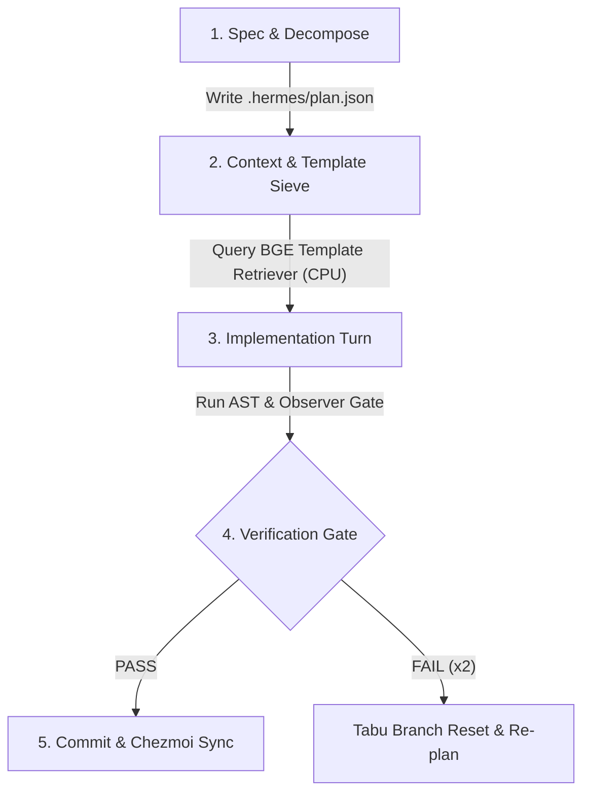

# AGENTS.md — Agent Operating Contract & Environment Handbook

> **Audience**: Autonomous AI Agents (Antigravity, Claude, Hermes, Codex)  
> **Mission**: Deliver deterministic, production-grade software engineering inside the `ws-hermes` workspace with **Zero Token Bloat**, **Strict Prefix Cache Alignment**, and **Zero VRAM Spikes**.

---

## 1. System & Environment Invariants

* **Active Container**: Distrobox container `ws-hermes` (Fedora Toolbox on Fedora Kinoite / Linux).
* **Working Directory**: `/var/home/imshubhamsocial/Projects/Workspace/Personal/hermes` (use relative paths or `~` / `$HOME`).
* **Python Toolchain**: Use `python3.13` strictly (with packages in `~/.local/lib` or user site).
* **Local Inference Server**: `llama-server` on `127.0.0.1:8138` running `gemma-4-4b` (`gemma-4-E4B-it-Q4_K_M.gguf`).
* **Hardware Ceiling**: NVIDIA RTX 3050 Laptop GPU ($6,144\text{ MiB}$ VRAM).
  * Static footprint: $\approx 3,745\text{ MiB}$ ($64\text{k KV cache}$ in `q4_0`).
  * Hard budget ceiling: **$\le 4,812\text{ MiB}$**. Never start extra GPU processes.

---

## 2. The 8 Golden Laws (Zero-Bloat Engineering)

```
┌──────────────────────────────────────────────────────────────────────────────────────────────────┐
│                                   THE 8 GOLDEN LAWS OF HERMES OS                                 │
├────┬───────────────────────────────┬─────────────────────────────────────────────────────────────┤
│ #  │ Law Name                      │ Mandatory Rule & Implementation Detail                      │
├────┼───────────────────────────────┼─────────────────────────────────────────────────────────────┤
│ 1  │ Zero-Token Waste              │ Never dump full files into context. Use PageRank spines     │
│    │                               │ (≤1,000 tok) for planning and AST slices (≤500 tok) for work│
├────┼───────────────────────────────┼─────────────────────────────────────────────────────────────┤
│ 2  │ Spec-First Contract           │ Always generate and persist formal milestones in            │
│    │                               │ `.hermes/plan.json` before modifying or generating code.    │
├────┼───────────────────────────────┼─────────────────────────────────────────────────────────────┤
│ 3  │ Deterministic Prefix Cache    │ Keep system prompt prefixes byte-identical. Put dynamic     │
│    │                               │ user input strictly at the tail to keep cache hit rate >90%.│
├────┼───────────────────────────────┼─────────────────────────────────────────────────────────────┤
│ 4  │ VRAM Guard Ceiling            │ Do not allocate GPU memory for embeddings or tools. Run BGE │
│    │                               │ vector search strictly on CPU ONNX (0 MB GPU contention).   │
├────┼───────────────────────────────┼─────────────────────────────────────────────────────────────┤
│ 5  │ Pre-Commit Observer Gate      │ Every file edit must pass the 6-point observer gate:        │
│    │                               │ AST syntax, brace balance, scope mutation, and token limits.│
├────┼───────────────────────────────┼─────────────────────────────────────────────────────────────┤
│ 6  │ 2-Strike Tabu Branch Pruning  │ If a repair patch fails 2 consecutive times, immediately    │
│    │                               │ reset branch and inject failure as a negative constraint.   │
├────┼───────────────────────────────┼─────────────────────────────────────────────────────────────┤
│ 7  │ Subagent Scratchpad Isolation │ Spawn subagents with read-only defaults in clean scratchpads│
│    │                               │ without polluting the parent trajectory.                    │
├────┼───────────────────────────────┼─────────────────────────────────────────────────────────────┤
│ 8  │ 100% Turnkey Portability      │ Never hardcode absolute paths (`/var/home/...`). Always path│
│    │                               │ relative to `$HOME` and commit dotfile updates to Chezmoi.  │
└────┴───────────────────────────────┴─────────────────────────────────────────────────────────────┘
```

---

## 3. Milestone Execution Protocol

When given a multi-step task, follow this exact 5-phase lifecycle:



### Phase 1: Spec & Decompose (Senior Engineer Phase)
1. Ingest prompt and analyze core domain interfaces.
2. Construct structured milestones and persist to `.hermes/plan.json`.
3. Enforce boundary invariants (e.g. zero uncaught runtime errors, test coverage criteria).

### Phase 2: Context Sieve & Canonical Template Retrieval
1. Do not hallucinate standard boilerplate from scratch.
2. Query `BGETemplateRetriever` (`template_retriever.py`) for verified canonical skeletons.
3. Slice only relevant target function signatures using Tree-Sitter AST indexer.

### Phase 3: Modular Synthesis
1. Write or patch files using focused, single-block changes.
2. Ensure modern language conventions:
   * **Python**: Type annotations, `dataclasses`, `pathlib.Path`, `asyncio`.
   * **JavaScript/TypeScript**: Strict ES-modules, modern Three.js canvas setup.
   * **C++**: C++20 concepts, RAII guards, smart pointers.

### Phase 4: Pre-Commit Observer Gate Verification
Always execute pre-commit verification before claiming task completion:
```bash
# 1. Run local observer gate on modified files
python3.13 bin/observer_gate.py <modified_file>

# 2. Run unit & contract test suite
python3.13 -m pytest tests/harness_contracts/ -v

# 3. Run self-audit verification runner
python3.13 bin/verify_harness_integrity.py
```

### Phase 5: Chezmoi Synchronization
Any change to `.hermes/`, `bin/`, `tests/`, `docs/`, `setup.sh`, or `packages.json` must be committed:
```bash
chezmoi add <changed_files>
chezmoi git -- add -A
chezmoi git -- commit -m "<type>(<scope>): descriptive commit message"
```

---

## 4. Key CLI Commands Quick Reference

| Action | Recommended Command |
| :--- | :--- |
| **Run Hermes Task** | `hermes chat -q "<prompt>" --yolo` |
| **Run Unified TaskDAG CLI** | `python3.13 bin/hermes_os_cli.py -z "<prompt>" --yolo` |
| **Run All Contract Tests** | `python3.13 -m pytest tests/harness_contracts/ -v` |
| **Run Full System Audit** | `python3.13 bin/verify_harness_integrity.py` |
| **Run Observer Gate** | `python3.13 bin/observer_gate.py <file>` |
| **Check VRAM Usage** | `nvidia-smi` (must stay $\le 4,812\text{ MiB}$) |
| **Check Chezmoi Status** | `chezmoi git -- status` |

---

## 5. Summary Directive for Agents

* **Be Concise**: State actions and verdicts clearly without conversational fluff.
* **Be Methodical**: Plan first (`plan.json`), implement cleanly, verify with observer gates, and commit to Chezmoi.
* **Respect Resources**: Protect GPU VRAM, maximize prefix caching, and avoid monolithic context dumps.
