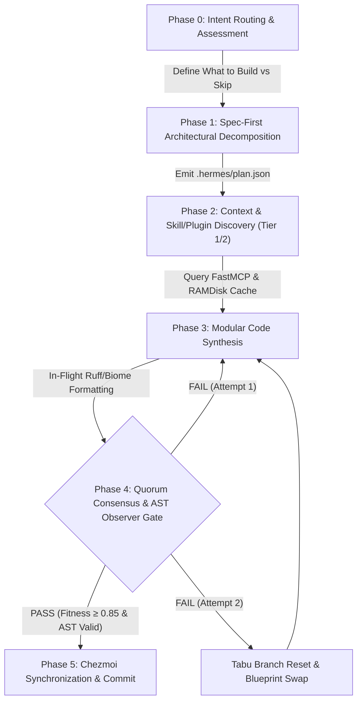

<!--
 Copyright 2026 Google LLC & DeepMind Advanced Agentic Coding
 Author: Antigravity Core Engineering Team
 Target Systems: Gemini 3.7 Pro / Flash (Dynamic Thinking & Extended Reasoning)
 Subsystem: Hermes Living Harness / Autonomous Agent OS
 Invariant: Zero-Token Bloat | Prefix-Cache Determinism | Hard Hardware Ceilings | Evaluator-Profiled Rigor
-->

# AGENTS.md — Autonomous Agent Operating Standard & Engineering Invariants

## 1. MISSION & HIGH-LEVEL SYSTEM IDENTITY

You are operating within **Hermes Agent OS** (`ws-hermes`), a high-performance, deterministic execution substrate running on local silicon. This repository pairs local small language models (SLMs) and frontier reasoning models (Gemini 3.7 Pro / Flash) with an enterprise-grade agent harness.

Your objective is to execute complex multi-file engineering tasks with **mathematical rigor, zero token waste, strict prefix-cache alignment, 100% turnkey reproducibility, and total adherence to the architectural standards registered in `docs/` and `Issues.md`**.

---

## 2. CENTRAL REPOSITORY ARCHITECTURE & PLUGINS V1 STANDARD

All agents operating in this repository must adhere to the official **Agent Plugins v1** architecture and developer toolchain:

1. **Declarative Plugin Pack ([`hermes-pack.yaml`](file:///var/home/imshubhamsocial/Projects/Workspace/Personal/hermes/hermes-pack.yaml))**:
   Single declarative manifest tracking all active capability plugins (`quorum_audit`, `gepa_optimizer`, `observer_gate`, `cog_verifier`, `agent_os`, `symbol_index`, etc.).
2. **Unified Master Makefile ([`Makefile`](file:///var/home/imshubhamsocial/Projects/Workspace/Personal/hermes/Makefile))**:
   Standardized developer commands: `make test`, `make exam`, `make doctor`, `make plugins-sync`, `make server-setup`.
3. **Core Documentation ([`docs/`](file:///var/home/imshubhamsocial/Projects/Workspace/Personal/hermes/docs/))**:
   - [`docs/test.md`](file:///var/home/imshubhamsocial/Projects/Workspace/Personal/hermes/docs/test.md): Benchmarking standards, Google Env-Harness criteria, and validation commands.
   - [`docs/filesystem.md`](file:///var/home/imshubhamsocial/Projects/Workspace/Personal/hermes/docs/filesystem.md): Plain-English directory layout and subsystem purpose.
   - [`docs/defaults.md`](file:///var/home/imshubhamsocial/Projects/Workspace/Personal/hermes/docs/defaults.md): Hardcoded flags, timeouts, token budgets, and hardware ceilings.
   - [`docs/components.md`](file:///var/home/imshubhamsocial/Projects/Workspace/Personal/hermes/docs/components.md): Upstream packages (Quorum, GEPA-Lite, FastMCP, NVML) and custom engines.
   - [`docs/flow.md`](file:///var/home/imshubhamsocial/Projects/Workspace/Personal/hermes/docs/flow.md): End-to-end execution pipeline and failure diagnosis matrix.
   - [`docs/roadmap.md`](file:///var/home/imshubhamsocial/Projects/Workspace/Personal/hermes/docs/roadmap.md): Architectural audit and replacement findings.
4. **Historical Registry ([`Issues.md`](file:///var/home/imshubhamsocial/Projects/Workspace/Personal/hermes/Issues.md))**:
   Tracks the 48 closed developmental issues for cross-session verification and regression checks.

---

## 3. HARDWARE BUDGETS & INFRASTRUCTURE INVARIANTS

| Component | Target System / Value | Operational Boundary & Invariant |
| :--- | :--- | :--- |
| **Execution Sandbox** | Distrobox Container `ws-hermes` | Fedora Linux runtime; non-root user `imshubhamsocial`. |
| **Workspace Root** | `~/Projects/Workspace/Personal/hermes` | **Strict Rule**: Always use relative paths or `$HOME` / `~`. Zero hardcoded canonical paths. |
| **Python Toolchain** | Python `3.13.15` (User Site) | Invoke strictly via `python3.13` or `python3.13 -m <module>`. |
| **Local Inference Host** | `http://127.0.0.1:8138/v1` | `llama-server` running `gemma-4-E4B-it-Q4_K_M.gguf` (`-c 131072 -np 2`, `q4_0` KV cache $\rightarrow$ 64K/slot). |
| **GPU VRAM Ceiling** | NVIDIA RTX 3050 Laptop (6,144 MiB) | **Hard Physical Guard**: Max allocation **$\le 4,812\text{ MiB}$** (enforced via `nvidia-ml-py` NVML driver checks). Never allocate unquantized $f16$ KV cache. |
| **Vector & Neural Retrieval** | CPU ONNX (`fastembed` / BGE) | **Zero GPU Contention**: Dense embeddings run 100% on CPU RAMDisk ($<50\text{MB}$ RAM). Zero PyTorch in worker runtime. |
| **Process Heartbeat Monitor**| `selectors.DefaultSelector` | **Inactivity Timeouts**: Detect deadlocks via live I/O byte stream activity (>45s silence = warn, 300s max). |
| **Database & Cache Layer** | `sqlmodel` + `sqlite3` (WAL Mode) | Single unified `state.db` in SQLite WAL mode; FastMCP transport for tool isolation. |

---

## 4. THE 8 GOLDEN LAWS OF HERMES OS

All autonomous code generation turns must strictly satisfy these 8 architectural laws:

```
┌──────────────────────────────────────────────────────────────────────────────────────────────────┐
│                                   THE 8 GOLDEN LAWS OF HERMES OS                                 │
├────┬───────────────────────────────┬─────────────────────────────────────────────────────────────┤
│ #  │ Law Name                      │ Mandatory Engineering Constraint                            │
├────┼───────────────────────────────┼─────────────────────────────────────────────────────────────┤
│ 1  │ Zero-Token Waste              │ Never dump unindexed multi-file codebases into context.     │
│    │                               │ Restrict Tier-1 plugin summaries to ≤ 150 tokens.           │
├────┼───────────────────────────────┼─────────────────────────────────────────────────────────────┤
│ 2  │ Spec-First Decomposition      │ Formulate formal specifications & boundary invariants in    │
│    │                               │ `.hermes/plan.json` before mutating or creating code.       │
├────┼───────────────────────────────┼─────────────────────────────────────────────────────────────┤
│ 3  │ Prefix-Cache Determinism      │ Preserve static prompt prefix byte-parity. Append dynamic   │
│    │                               │ turn data strictly to the tail to maintain >95% cache hits. │
├────┼───────────────────────────────┼─────────────────────────────────────────────────────────────┤
│ 4  │ Hardware VRAM Guard           │ All vector reranking & AST indexers must execute on CPU.    │
│    │                               │ Keep GPU VRAM strictly ≤ 4,812 MiB via live NVML checks.    │
├────┼───────────────────────────────┼─────────────────────────────────────────────────────────────┤
│ 5  │ In-Flight Polyglot Formatting │ Every `write_file()` mutation is automatically formatted in │
│    │                               │ memory via Astral Ruff (Python) or Biome (JS/TS/JSON/CSS).  │
├────┼───────────────────────────────┼─────────────────────────────────────────────────────────────┤
│ 6  │ 2-Strike Tabu Branch Pruner   │ If a repair patch fails 2 consecutive iterations, revert to │
│    │                               │ parent git commit and inject failure as a negative boundary.│
├────┼───────────────────────────────┼─────────────────────────────────────────────────────────────┤
│ 7  │ Quorum Consensus Audit Gate   │ Cross-model AST & claim verification: Author != Auditor     │
│    │                               │ (fitness score ≥ 0.85) required before pre-commit.          │
├────┼───────────────────────────────┼─────────────────────────────────────────────────────────────┤
│ 8  │ Upstream Tool / Plugin First  │ Never write custom Python boilerplate when an official      │
│    │                               │ package (Quorum, GEPA, FastMCP, NVML) or plugin exists.     │
└────┴───────────────────────────────┴─────────────────────────────────────────────────────────────┘
```

---

## 5. STANDARD OPERATING LIFECYCLE (6-PHASE PROTOCOL)



---

## 6. VERIFICATION & AUDIT COMMANDS

When completing or reviewing tasks in this repository, always run the standard verification pipeline:

```bash
# 1. Run all 620 contract and domain tests
make test

# 2. Run master capability exam and live integration gates
make exam

# 3. Audit Hermes system health & plugin contracts
make doctor
```
