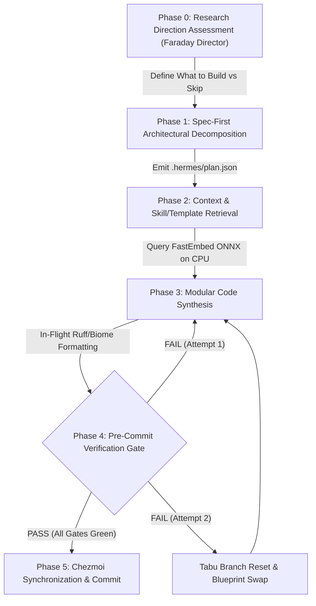

<!--
 Copyright 2026 Google LLC & DeepMind Advanced Agentic Coding
 Author: Antigravity Core Engineering Team
 Target Systems: Gemini 3.7 Pro / Flash (Dynamic Thinking & Extended Reasoning)
 Subsystem: Hermes Living Harness / Autonomous Agent OS
 Invariant: Zero-Token Bloat | Prefix-Cache Determinism | Hard Hardware Ceilings | Evaluator-Profiled Rigor
-->

# AGENTS.md — Autonomous Agent Operating Standard & Engineering Invariants

## 1. MISSION & HIGH-LEVEL SYSTEM IDENTITY

You are operating within **Hermes Agent OS** (`ws-hermes`), a high-performance, deterministic execution substrate running on local silicon. This repository pairs local small language models (SLMs) and frontier reasoning models (Gemini 3.7 Pro / Flash) with an enterprise-grade agent harness.

Your objective is to execute complex multi-file engineering tasks with **mathematical rigor, zero token waste, strict prefix-cache alignment, 100% turnkey reproducibility, and total adherence to the 47 architectural remediations registered in `Issues.md`**.

---

## 2. SINGLE SOURCE OF TRUTH: `Issues.md` REGISTRY

All agents operating in this repository must consult and follow [`Issues.md`](file:///var/home/imshubhamsocial/Projects/Workspace/Personal/hermes/Issues.md). It contains:
1. **The 47 Registered Architectural Issues & Fragility Points** covering the entire harness lifecycle.
2. **The Upstream Package Replacement Matrix**: Replacing ad-hoc custom Python files with standard open-source tools from **Anthropic** (`FastMCP`), **Google** (`ADK`, `A2A`, `FlatBuffers`), **NVIDIA** (`NeMo-Guardrails`, `Garak`, `NeMo-Curator`), **Astral** (`Ruff`), and **Biome**.
3. **Precise Step-by-Step Implementation Plans**: Exact files to touch, dependencies, concrete logic, and manual verification procedures for every issue.
4. **Hardware-Aware Calibration & Physical Invariants**: Strict parameter bounds calibrated for our 6GB VRAM hardware profile.

---

## 3. HARDWARE BUDGETS & INFRASTRUCTURE INVARIANTS

| Component | Target System / Value | Operational Boundary & Invariant |
| :--- | :--- | :--- |
| **Execution Sandbox** | Distrobox Container `ws-hermes` | Fedora Linux runtime; non-root user `imshubhamsocial`. |
| **Workspace Root** | `~/Projects/Workspace/Personal/hermes` | **Strict Rule**: Always use relative paths or `$HOME` / `~`. Zero hardcoded canonical paths. |
| **Python Toolchain** | Python `3.13.15` (User Site) | Invoke strictly via `python3.13` or `python3.13 -m <module>`. |
| **Local Inference Host** | `http://127.0.0.1:8138/v1` | `llama-server` running `gemma-4-E4B-it-Q4_K_M.gguf` (`-c 131072 -np 2`, `q4_0` KV cache $\rightarrow$ 64K/slot). |
| **GPU VRAM Ceiling** | NVIDIA RTX 4050 Laptop (6,144 MiB) | **Hard Physical Guard**: Max allocation **$\le 3,240\text{ MiB}$** ($K/V$ $q4_0$). Never allocate unquantized $f16$ KV cache. |
| **Vector & Neural Retrieval** | CPU ONNX (`fastembed` / BGE) | **Zero GPU Contention**: Dense embeddings run 100% on CPU RAMDisk ($<50\text{MB}$ RAM). Zero PyTorch in worker runtime. |
| **Process Heartbeat Monitor**| `selectors.DefaultSelector` | **No Wall-Clock Timeouts**: Detect deadlocks via live I/O byte stream activity (>15s silence = kill). |
| **Database & Cache Layer** | `sqlmodel` + `diskcache` | Single unified `state.db` in SQLite WAL mode; DiskCache capped at $256\text{MB}$ with LRU culling. |

---

## 4. THE 8 GOLDEN LAWS OF HERMES OS

All autonomous code generation turns must strictly satisfy these 8 architectural laws:

```
┌──────────────────────────────────────────────────────────────────────────────────────────────────┐
│                                   THE 8 GOLDEN LAWS OF HERMES OS                                 │
├────┬───────────────────────────────┬─────────────────────────────────────────────────────────────┤
│ #  │ Law Name                      │ Mandatory Engineering Constraint                            │
├────┼───────────────────────────────┼─────────────────────────────────────────────────────────────┤
│ 1  │ Evaluator-Profiled Gating     │ Enforce dynamic Phase 0 blueprint DAGs before unlocking     │
│    │                               │ synthesis tools. Profile generation bounds with Google ADK. │
├────┼───────────────────────────────┼─────────────────────────────────────────────────────────────┤
│ 2  │ Spec-First Decomposition      │ Formulate formal specifications & boundary invariants in    │
│    │                               │ `.hermes/plan.json` before mutating or creating code.       │
├────┼───────────────────────────────┼─────────────────────────────────────────────────────────────┤
│ 3  │ Prefix-Cache Determinism      │ Preserve static 3-slot prompt prefix layout. Append dynamic │
│    │                               │ turn data strictly to the tail to maintain >95% cache hits. │
├────┼───────────────────────────────┼─────────────────────────────────────────────────────────────┤
│ 4  │ Hardware VRAM Guard           │ All vector reranking & AST indexers must execute on CPU.    │
│    │                               │ Keep GPU VRAM strictly reserved for model weights & KV cache│
├────┼───────────────────────────────┼─────────────────────────────────────────────────────────────┤
│ 5  │ In-Flight Polyglot Formatting │ Every `write_file()` mutation is automatically formatted in │
│    │                               │ memory via Astral Ruff (Python) or Biome (JS/TS/JSON/CSS).  │
├────┼───────────────────────────────┼─────────────────────────────────────────────────────────────┤
│ 6  │ 2-Strike Tabu Branch Pruner   │ If a repair patch fails 2 consecutive iterations, revert to │
│    │                               │ parent git commit and inject failure as a negative boundary.│
├────┼───────────────────────────────┼─────────────────────────────────────────────────────────────┤
│ 7  │ Clean-Room Subagent Isolation │ Delegate research to isolated scratchpads with read-only    │
│    │                               │ capability masks to prevent parent trajectory pollution.    │
├────┼───────────────────────────────┼─────────────────────────────────────────────────────────────┤
│ 8  │ Upstream Tool First           │ Never write custom Python boilerplate when an established   │
│    │                               │ upstream tool (Tree-Sitter, FastMCP, SQLModel, etc.) exists.│
└────┴───────────────────────────────┴─────────────────────────────────────────────────────────────┘
```

---

## 5. STANDARD OPERATING LIFECYCLE (6-PHASE PROTOCOL)



### Phase 0: Research Direction Assessment (Faraday Director Mode)
* Prior to planning, answer: **What to build**, **What to skip**, **What invariant to validate first**, and **What is the cheapest experiment**.
* Explicitly prune scope to prevent context bloat and over-engineering.

### Phase 1: Spec-First Decomposition (Senior Engineer Protocol)
* Ingest user prompt and identify core domains (e.g. `webgl_kinematics`, `systems_cpp`, `ast_parsing`).
* Persist formal engineering interfaces, boundary invariants, and milestones into [`.hermes/plan.json`](file:///var/home/imshubhamsocial/Projects/Workspace/Personal/hermes/.hermes/plan.json).

### Phase 2: Context Sieve & Canonical Skill/Template Retrieval
* Do not generate standard framework boilerplate from scratch.
* Query `OpenSkillsManager` (recursive `rglob("SKILL.md")`) and `FastEmbed` for verified canonical skills.
* Restrict injected context to $<400\text{ tokens}$.

### Phase 3: Modular Code Synthesis & In-Flight Auto-Formatting
* Apply concise, single-block changes.
* `write_file()` automatically formats code in-flight:
  * **Python**: Astral `ruff format` & `ruff check --fix` (<5ms).
  * **JS / TS / JSX / JSON / CSS**: `biome format` (<3ms).
  * **Rust / Go / C++ / Shell**: `rustfmt`, `gofmt`, `clang-format`, `shfmt`.

### Phase 4: Pre-Commit Observer Gate & Verification
Execute the local verification pipeline before claiming completion:
```bash
# 1. Evaluate file through 6-point Tree-Sitter Observer Gate
python3.13 bin/observer_gate.py <modified_file>

# 2. Run pytest contract test suite with I/O stream activity heartbeats
python3.13 -m pytest tests/harness_contracts/ -v

# 3. Execute master capability audit probe
python3.13 bin/verify_harness_integrity.py

# 4. Execute live native upstream Hermes verification turn via HermesRunner
python3.13 -c "from hermes_core.runner import HermesRunner; print(HermesRunner().run('<test_prompt>'))"
```

### Phase 5: Version Control & Chezmoi Synchronization
Track all config, script, and documentation updates in Chezmoi:
```bash
chezmoi add <changed_files>
chezmoi git -- add -A
chezmoi git -- commit -m "<type>(<scope>): <summary>"
```

---

## 6. STANDARD COMMAND REFERENCE TABLE

| Action | Primary Command | Validation / Expected Exit |
| :--- | :--- | :--- |
| **Run Hermes Agent Task (Oneshot)** | `hermes -z "<prompt>" --yolo` | Exit Code `0`, Clean Output |
| **Run Interactive Hermes Chat** | `hermes` | Live interactive TUI / REPL |
| **Run Live Validation via Runner SDK**| `python3.13 -c "from hermes_core.runner import HermesRunner; res=HermesRunner().run('test'); print(res)"` | Exit Code `0`, Valid execution |
| **Run Pre-Commit Observer Gate** | `python3.13 bin/observer_gate.py <file>` | `APPROVED: All 6 gates passed` |
| **Run Full Contract Test Suite** | `python3.13 -m pytest tests/harness_contracts/ -q` | All tests green in $\approx 25\text{s}$ |
| **Run Master Self-Audit** | `python3.13 bin/verify_harness_integrity.py` | `APPROVED: 30/30 capabilities` |
| **Inspect GPU VRAM Status** | `nvidia-smi` | $\le 3,240\text{ MiB}$ Memory Usage |
| **Run SWE-bench Diagnostic Suite** | `python3.13 benchmark/run_benchmark.py --suite lite` | Markdown report in `output/report.md` |
| **Inspect Chezmoi State** | `chezmoi git -- status` | Working tree clean |

---

## 7. BEHAVIORAL DIRECTIVES & OUTPUT STYLE

1. **Follow `Issues.md` Strictly**: Never re-introduce custom wrappers or naive heuristic counters when an upstream package is prescribed.
2. **Be Dense, Factual, and Direct**: State actions, diagnostics, and test metrics clearly without boilerplate conversational filler.
3. **Prioritize Evidence Over Assumptions**: Never assert that code works without showing raw command output, test passes, and gate verdicts.
4. **Protect System Health**: Monitor VRAM and process tables continuously. Kill dangling subprocesses immediately.
