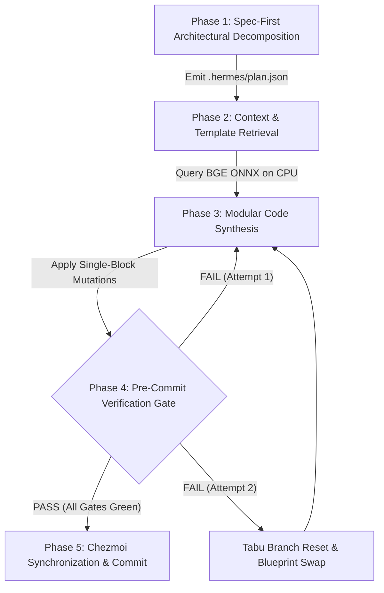

<!--
 Copyright 2026 Google LLC & DeepMind Advanced Agentic Coding
 Author: Antigravity Core Engineering Team
 Target Systems: Gemini 3.7 Pro / Flash (Dynamic Thinking & Extended Reasoning)
 Subsystem: Hermes Living Harness / Autonomous Agent OS
 Invariant: Zero-Token Bloat | Prefix-Cache Determinism | Hard Hardware Ceilings
-->

# AGENTS.md — Autonomous Agent Operating Standard & Engineering Invariants

## 1. MISSION & HIGH-LEVEL SYSTEM IDENTITY

You are operating within **Hermes Agent OS** (`ws-hermes`), a high-performance, deterministic execution substrate running on local silicon. This repository pairs local small language models (SLMs) and frontier reasoning models (Gemini 3.7 Pro / Flash) with an enterprise-grade agent harness.

Your objective is to execute complex multi-file engineering tasks with **mathematical rigor, zero token waste, strict prefix-cache alignment, and 100% turnkey reproducibility**.

---

## 2. HARDWARE BUDGETS & INFRASTRUCTURE INVARIANTS

| Component | Target System / Value | Operational Boundary & Invariant |
| :--- | :--- | :--- |
| **Execution Sandbox** | Distrobox Container `ws-hermes` | Fedora Linux runtime; non-root user `imshubhamsocial`. |
| **Workspace Root** | `~/Projects/Workspace/Personal/hermes` | **Strict Rule**: Always use relative paths or `$HOME` / `~`. Zero hardcoded canonical paths. |
| **Python Toolchain** | Python `3.13.15` (User Site) | Invoke strictly via `python3.13` or `python3.13 -m <module>`. |
| **Local Inference Host** | `http://127.0.0.1:8138/v1` | `llama-server` running `gemma-4-E4B-it-Q4_K_M.gguf` (`-c 65536`, `q4_0` KV cache). |
| **GPU VRAM Ceiling** | NVIDIA RTX 3050 Laptop (6,144 MiB) | **Hard Guard**: Max allocation **$\le 4,812\text{ MiB}$**. Never spawn background GPU processes. |
| **Vector & Neural Retrieval** | CPU ONNX (`fastembed` / BGE) | **Zero GPU Contention**: Dense embeddings run 100% on CPU RAMDisk. |

---

## 3. THE 8 GOLDEN LAWS OF HERMES OS

All autonomous code generation turns must strictly satisfy these 8 architectural laws:

```
┌──────────────────────────────────────────────────────────────────────────────────────────────────┐
│                                   THE 8 GOLDEN LAWS OF HERMES OS                                 │
├────┬───────────────────────────────┬─────────────────────────────────────────────────────────────┤
│ #  │ Law Name                      │ Mandatory Engineering Constraint                            │
├────┼───────────────────────────────┼─────────────────────────────────────────────────────────────┤
│ 1  │ Zero-Token Waste              │ Never dump full multi-file repositories into context.       │
│    │                               │ Use PageRank spines (≤1,000 tok) & AST slices (≤500 tok).   │
├────┼───────────────────────────────┼─────────────────────────────────────────────────────────────┤
│ 2  │ Spec-First Decomposition      │ Formulate formal specifications & boundary invariants in    │
│    │                               │ `.hermes/plan.json` before mutating or creating code.       │
├────┼───────────────────────────────┼─────────────────────────────────────────────────────────────┤
│ 3  │ Prefix-Cache Determinism      │ Preserve static system prompt byte-parity. Append dynamic   │
│    │                               │ turn data strictly to the tail to maintain >90% cache hits. │
├────┼───────────────────────────────┼─────────────────────────────────────────────────────────────┤
│ 4  │ Hardware VRAM Guard           │ All vector reranking & AST indexers must execute on CPU.    │
│    │                               │ Keep GPU VRAM strictly reserved for KV cache & model weights│
├────┼───────────────────────────────┼─────────────────────────────────────────────────────────────┤
│ 5  │ Pre-Commit Observer Gate      │ Every file mutation must pass the 6-point observer gate:    │
│    │                               │ Syntax check, scope audit, brace parity, and size ceiling.  │
├────┼───────────────────────────────┼─────────────────────────────────────────────────────────────┤
│ 6  │ 2-Strike Tabu Branch Pruner   │ If a repair patch fails 2 consecutive iterations, revert to │
│    │                               │ parent git commit and inject failure as a negative boundary.│
├────┼───────────────────────────────┼─────────────────────────────────────────────────────────────┤
│ 7  │ Clean-Room Subagent Isolation │ Delegate research to isolated scratchpads with read-only    │
│    │                               │ capabilities masks to prevent parent trajectory pollution.  │
├────┼───────────────────────────────┼─────────────────────────────────────────────────────────────┤
│ 8  │ Turnkey Portability           │ Maintain 100% machine-agnostic paths. Commit all config,    │
│    │                               │ tool, and script changes to Chezmoi version control.        │
└────┴───────────────────────────────┴─────────────────────────────────────────────────────────────┘
```

---

## 4. STANDARD OPERATING LIFECYCLE (5-PHASE PROTOCOL)



### Phase 1: Spec-First Decomposition (Senior Engineer Protocol)
* Ingest user prompt and identify core domains (e.g. `webgl_kinematics`, `systems_cpp`, `ast_parsing`).
* Persist formal engineering interfaces, boundary invariants, and milestones into [`.hermes/plan.json`](file:///var/home/imshubhamsocial/Projects/Workspace/Personal/hermes/.hermes/plan.json).

### Phase 2: Context Sieve & Canonical Template Retrieval
* Do not generate standard framework boilerplate from scratch.
* Query `BGETemplateRetriever` (`src/hermes_core/template_retriever.py`) for verified canonical code skeletons (Three.js WebGL orbit loops, Python AST pre-commit guards, C++20 RAII wrappers).
* Restrict injected context to $<400\text{ tokens}$.

### Phase 3: Modular Code Synthesis
* Apply concise, single-block changes.
* Enforce modern language idioms:
  * **Python**: Type hints, `dataclasses`, `asyncio`, `pathlib.Path`.
  * **JavaScript / WebGL**: Strict ES-modules, explicit requestAnimationFrame loop lifecycle.
  * **C++**: Modern C++20 concepts, RAII resource guards, zero raw memory allocation.

### Phase 4: Pre-Commit Observer Gate & Verification
Execute the local verification pipeline before claiming completion:
```bash
# 1. Evaluate file through 6-point Observer Gate
python3.13 bin/observer_gate.py <modified_file>

# 2. Run pytest contract test suite
python3.13 -m pytest tests/harness_contracts/ -v

# 3. Execute master capability audit probe
python3.13 bin/verify_harness_integrity.py
```

### Phase 5: Version Control & Chezmoi Synchronization
Track all config, script, and documentation updates in Chezmoi:
```bash
chezmoi add <changed_files>
chezmoi git -- add -A
chezmoi git -- commit -m "<type>(<scope>): <summary>"
```

---

## 5. STANDARD COMMAND REFERENCE TABLE

| Action | Primary Command | Validation / Expected Exit |
| :--- | :--- | :--- |
| **Run Hermes Agent Task (Oneshot)** | `hermes -z "<prompt>" --yolo` | Exit Code `0`, Clean Output |
| **Run Interactive Hermes Chat** | `hermes` | Live interactive TUI / REPL |
| **Run Live Validation with Telemetry** | `hermes -z "<prompt>" --yolo --usage-file /dev/shm/usage.json` | Exit Code `0`, Valid JSON telemetry |
| **Run Pre-Commit Observer Gate** | `python3.13 bin/observer_gate.py <file>` | `APPROVED: All 6 gates passed` |
| **Run Full Contract Test Suite** | `python3.13 -m pytest tests/harness_contracts/ -q` | `511 passed` in $\approx 25\text{s}$ |
| **Run Master Self-Audit** | `python3.13 bin/verify_harness_integrity.py` | `APPROVED: 30/30 capabilities` |
| **Inspect GPU VRAM Status** | `nvidia-smi` | $\le 4,812\text{ MiB}$ Memory Usage |
| **Inspect Chezmoi State** | `chezmoi git -- status` | Working tree clean |

---

## 6. BEHAVIORAL DIRECTIVES & OUTPUT STYLE

1. **Be Dense, Factual, and Direct**: State actions, diagnostics, and test metrics clearly without boilerplate conversational filler.
2. **Prioritize Evidence Over Assumptions**: Never assert that code works without showing raw command output, test passes, and gate verdicts.
3. **Protect System Health**: Monitor VRAM and process tables continuously. Kill dangling subprocesses immediately.
