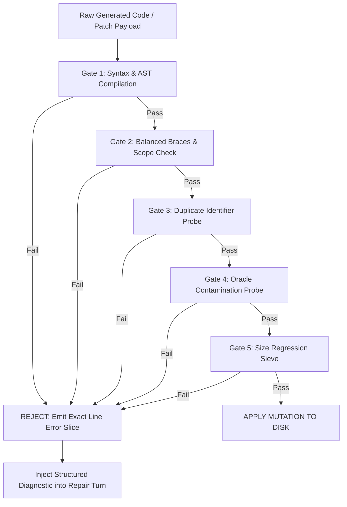

# TEST PLAN: FAILURE MODES, REGRESSIONS & EDGE-CASE TEST SUITE
## Stress-Testing Historical 4B SLM Failure Modes, Observer Gate Pre-Commits & Self-Healing Feedback Loops

> **Document ID**: `Desktop/hermes/roadmap3/03_FAILURE_MODES_REGRESSIONS_AND_EDGE_CASE_TEST_SUITE.md`  
> **Target Subsystem**: Observer Gate (`bin/observer_gate.py`), Lifecycle Hooks (`hooks.py`), & Self-Healing Loop  
> **Prerequisites**: Master Ledgers (§21, §25, §27, §29, §32) & Roadmap 1/2 Guardrails  
> **Verification Standard**: 100% Interception of Known Failure Modes with Zero Unhandled Regressions

---

## 1. Historical Failure Mode Taxonomy (The 8 Core Traps)

Across our extensive benchmark runs and ledger audits, we identified 8 repeatable cognitive and execution failure modes unique to local 4B parameter models operating under constrained hardware envelopes. The single Hermes binary must be verified against every single one of these failure modes:

```
┌────────────────────────────────────────────────────────────────────────────────────────────────────────┐
│                              THE 8 HISTORICAL 4B AGENT FAILURE MODES                                  │
├────────┬──────────────────────────────────┬────────────────────────────────────────────────────────────┤
│ Trap # │ Failure Taxonomy                 │ Observed Symptom & Root Cause                              │
├────────┼──────────────────────────────────┼────────────────────────────────────────────────────────────┤
│ FM-01  │ Duplicate Declaration Patch Trap │ Unscoped `const`/`let` added in patch colliding with scope.│
│ FM-02  │ Context Compaction GPU Freeze    │ Session >25 turns locks GPU at 97% load for 3–5 minutes.   │
│ FM-03  │ Silent Tool Drop & Hallucination │ Model claims code is written in prose without tool calling.│
│ FM-04  │ Markdown & Fence Escapes         │ Conversational text around code crashes direct interpreters│
│ FM-05  │ Accidental Function Nesting      │ Missing closing brace nests all downstream functions in init│
│ FM-06  │ Tool Calling Loop Lock           │ Endless repeated queries on identical failing parameters.  │
│ FM-07  │ GPU VRAM Spike & OOM Crash       │ Memory exceeds 4GB GDDR6 limit, triggering driver crash.   │
│ FM-08  │ Stale Git Tree & Inode Wear      │ Uncleaned ephemeral worktrees cause Btrfs metadata bloat.  │
└────────┴──────────────────────────────────┴────────────────────────────────────────────────────────────┘
```

---

## 2. Invariant Pre-Commit Gating: The Observer Gate (Astra Pattern)

To guarantee that broken code artifacts never reach disk or corrupt the repository, all file mutations must pass through the **Observer Gate** (`bin/observer_gate.py` / `src/hermes_core/hooks.py`) before filesystem application:



### 2.1 The 5 Pre-Commit Invariant Gates
1. **Gate 1 (Syntax & AST Validation)**: Runs headless compiler (`python -m py_compile` for Python, `node -c` for JavaScript/HTML) to verify 0 parse errors.
2. **Gate 2 (Brace & Block Balance)**: Verifies that opening `{`, `(`, `[` match closing `}`, `)`, `]` exactly.
3. **Gate 3 (Duplicate Identifier Probe)**: Validates that top-level identifiers (e.g. `raycaster`, `BALL_RADIUS`, `camera`) are declared at most once.
4. **Gate 4 (Clean-Room Oracle Isolation)**: Scans payload for forbidden oracle strings or reference leaks (`gold_standard.html`, `oracle_references/`).
5. **Gate 5 (Size Regression Sieve)**: Rejects patches that unintentionally truncate files by $>40\%$ without explicit architectural intent.

---

## 3. Comprehensive Failure Injection Test Battery

### Test Case FM-01: Duplicate Declaration Patch Trap
* **Defect Injected**: Feed an existing file containing `const raycaster = new THREE.Raycaster();` to Hermes and instruct it to add raycasting interaction.
* **Failure Condition**: Model attempts to prepend `const raycaster = ...` at the top of the file without removing the lower declaration.
* **Expected Interceptor Behavior**: Gate 3 catches `Identifier 'raycaster' has already been declared`; blocks disk write; returns exact duplicate line number to `@coder`.
* **Pass Criteria**: Disk file remains uncorrupted; model wraps variables in single-namespace container (`const SIM = { ... }`) on repair turn.

### Test Case FM-02: Context Compaction GPU Freeze
* **Defect Injected**: Feed a synthetic 50-message conversational history (>15,000 tokens of raw tool diffs) to Hermes.
* **Failure Condition**: Model attempts to run a full 4B generation pass over old tool diffs, locking GPU for 3+ minutes.
* **Expected Interceptor Behavior**: Token Economy engine (`token_engine.py`) performs differential compaction; strips old stdout dumps; restores fresh scratchpad (<350 tokens).
* **Pass Criteria**: GPU load spike $\le 15\text{s}$; context compaction freeze is 100% avoided.

### Test Case FM-03: Silent Tool Drop & Hallucinated Mutations
* **Defect Injected**: Prompt Hermes: `"Refactor /dev/shm/calc.py to support exponentiation"`.
* **Failure Condition**: Model outputs natural language response (`"I have updated calc.py to support exponentiation"`) with zero tool calls.
* **Expected Interceptor Behavior**: Orchestrator verifies that if prompt requested file mutation, a filesystem tool (`write_file`, `patch_file`, `code_mode`) MUST have executed.
* **Pass Criteria**: Orchestrator flags missing tool invocation; prompts model to emit actual tool call.

### Test Case FM-04: Markdown & Code Fence Escapes
* **Defect Injected**: Model returns mixed conversational prose and markdown fences:
  ```
  Here is the patch for the bug:
  ```python
  def fix(): return True
  ```
  I hope this helps!
  ```
* **Failure Condition**: Direct code interpreter crashes with `SyntaxError: invalid syntax` on prose text.
* **Expected Interceptor Behavior**: `extract_code_mode.py` regex extractor strips conversational headers/footers and unescapes fences cleanly.
* **Pass Criteria**: Interpreted code AST compiles cleanly without manual human sanitization.

### Test Case FM-05: Accidental Function Nesting (Brace Collision)
* **Defect Injected**: Model emits patch omitting a closing `}` after event handler setup.
* **Failure Condition**: All subsequent functions are nested inside `initScene()`, causing `ReferenceError: updatePhysics is not defined`.
* **Expected Interceptor Behavior**: Gate 2 flags brace imbalance ($\Delta = -1$); blocks disk write.
* **Pass Criteria**: Patch is rejected at the gate; model repairs brace balance in $<10\text{s}$.

### Test Case FM-06: Tool Calling Loop Lock (Idempotent Stall)
* **Defect Injected**: Simulate an environment where `read_file("missing.py")` returns `FileNotFoundError`.
* **Failure Condition**: Model calls `read_file("missing.py")` 5 consecutive times in an infinite loop.
* **Expected Interceptor Behavior**: Tool loop guardrail detects 2 identical failures ➔ emits warning; on 5 failures ➔ triggers hard stop and branch swap.
* **Pass Criteria**: Execution halts; Hypothesis Tree backtracks to alternate search strategy.

### Test Case FM-07: GPU VRAM Spike & OOM Crash
* **Defect Injected**: Trigger embedding query on 500 documents while running speculative 4B generation.
* **Failure Condition**: GPU VRAM exceeds 4,000 MiB, causing CUDA OOM crash.
* **Expected Interceptor Behavior**: CPU Neural Embedding engine (`embeddings.py` BGE-Small ONNX) executes 100% on CPU with 0 MB GPU VRAM allocation.
* **Pass Criteria**: Peak GPU VRAM remains $\le 3,800\text{ MiB}$ throughout entire execution.

### Test Case FM-08: Stale Git Working Tree & Inode Wear
* **Defect Injected**: Spawn 20 consecutive ephemeral subagent worktrees.
* **Failure Condition**: Temporary files accumulate on NVMe disk, causing Btrfs fragmentation and inode exhaustion.
* **Expected Interceptor Behavior**: Ephemeral worktrees are provisioned in `/dev/shm` (RAMDisk) with `chattr +C` attributes and auto-purged on exit.
* **Pass Criteria**: Host NVMe write delta is $<10\text{ KB}$; RAMDisk cleans up 100% of temporary directories.

---

## 4. Telemetry Sieving & Error Slicing (`TelemetrySieve`)

When external test runners (Playwright / Pytest / Pyright) fail, raw output can exceed 2,000 lines (30,000+ tokens), which would instantly drown a 4B model's context window.

```
┌────────────────────────────────────────────────────────────────────────────────────────────────────────┐
│                                 TELEMETRY SIEVE FILTERING PIPELINE                                    │
├────────────────────────────────┬───────────────────────────────────────────────────────────────────────┤
│ Raw Input Stream               │ Sieve Extraction Mechanism & Output Bounding                          │
├────────────────────────────────┼───────────────────────────────────────────────────────────────────────┤
│ 2,000-line Chromium WebGL Log  │ ➔ Strips info logs, animation frames, and warnings.                  │
│                                │ ➔ Extracts exact JavaScript runtime exception & line number.          │
│                                │ ➔ Bounds diagnostic payload to $\le 80\text{ tokens}$.                │
├────────────────────────────────┼───────────────────────────────────────────────────────────────────────┤
│ 500-line Pytest Stack Trace    │ ➔ Strips internal pytest framework frames.                            │
│                                │ ➔ Extracts failing assertion expression and diff values.              │
│                                │ ➔ Bounds diagnostic payload to $\le 60\text{ tokens}$.                │
└────────────────────────────────┴───────────────────────────────────────────────────────────────────────┘
```

---

## 5. Pass/Fail Evaluation Criteria

A test run of the Failure Modes & Regressions Test Suite passes if and only if:
1. **Zero Uncaught Invariants**: 100% of injected FM-01 through FM-08 failure conditions are successfully caught and isolated by active guardrails.
2. **Pre-Commit Integrity**: Exactly 0 broken syntax or brace-mismatched files are committed to disk.
3. **Hardware Safety**: Peak VRAM remains strictly $<3,800\text{ MiB}$; 0 zombie PIDs or uncleaned process groups.
4. **Self-Healing Velocity**: 100% of caught gate errors are resolved by the model within $\le 2$ repair turns.
