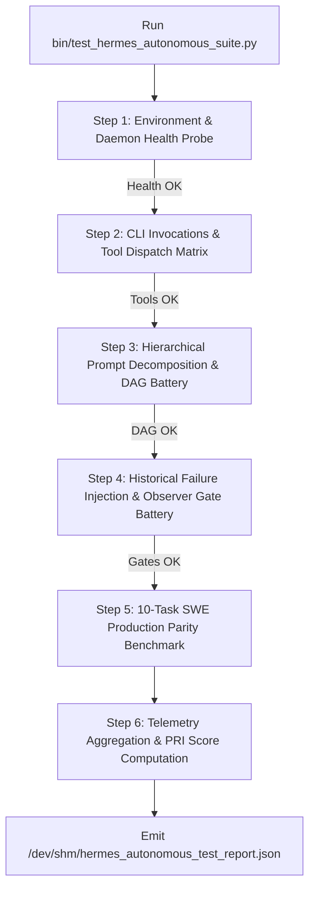

# TEST PLAN: HARDWARE-CALIBRATED TEST RUNNERS & AUTOMATION HARNESS
## End-to-End Test Orchestration, Sub-50ms System Telemetry, VRAM Protection & Automated Pass/Fail Arbiters

> **Document ID**: `Desktop/hermes/roadmap3/05_HARDWARE_CALIBRATED_TEST_RUNNERS_AND_AUTOMATION_HARNESS.md`  
> **Target Runner Script**: `bin/test_hermes_autonomous_suite.py` & Automated Verification Scripts  
> **Hardware Budget**: NVIDIA RTX 3050 Laptop (4GB VRAM / CC 8.6), 16GB Host RAM, Btrfs Root  
> **Storage Standard**: `/dev/shm` (RAMDisk) for SQLite DBs & Trajectories + `chattr +C` (NOCOW)

---

## 1. Hardware Calibration & Execution Boundaries

To ensure that the test battery can run continuously in local development and production CI without freezing the system or damaging hardware, all test runners must operate within strict physical boundaries:

```
┌────────────────────────────────────────────────────────────────────────────────────────────────────────┐
│                              HARDWARE CALIBRATION & SAFETY ENVELOPES                                  │
├───────────────────────┬─────────────────────────────┬──────────────────────────────────────────────────┤
│ Parameter             │ Calibrated Ceiling / Value  │ Hardware Rationale & Safety Constraint           │
├───────────────────────┼─────────────────────────────┼──────────────────────────────────────────────────┤
│ Maximum GPU VRAM      │ $\le 3,800\text{ MiB}$      │ Leaves 296 MiB headroom below physical 4GB GDDR6 │
│ Turn Execution Budget │ $\le 25.0\text{ seconds}$   │ Fast turnaround preventing thermal throttling    │
│ Single-Turn Prefill   │ $\le 2,048\text{ tokens}$   │ Sub-100ms prompt prefill via CUDA FlashAttention │
│ Max Turn Output       │ $\le 4,096\text{ tokens}$   │ Prevents runaway token generation locks          │
│ CPU Neural Overhead   │ $0\text{ MB GPU VRAM}$      │ BGE-Small ONNX runs strictly on CPU threads      │
│ Filesystem Storage    │ `/dev/shm` (RAMDisk)        │ 0 NVMe NAND flash wear; 0 Btrfs metadata bloat   │
│ High-Write Files      │ `chattr +C` (NOCOW)         │ Btrfs Copy-on-Write fragmentation prevention     │
│ Process Teardown      │ $\le 15\text{ms}$ PGID kill │ `kill -- -$PGID` eliminates background zombies   │
└───────────────────────┴─────────────────────────────┴──────────────────────────────────────────────────┘
```

---

## 2. Automated Test Runner Architecture (`bin/test_hermes_autonomous_suite.py`)

The test suite is structured as a unified, deterministic Python test runner executing the 5 core test batteries sequentially:



### 2.1 Sequential Test Execution Stages

#### Stage 1: Pre-Flight & Health Checks (<2s)
- Verifies `llama-server` is healthy on port `8138` (`GET /health`).
- Verifies `nvidia-smi` reports available VRAM $\ge 1,000\text{ MiB}$ and current allocation $\le 3,500\text{ MiB}$.
- Verifies Bubblewrap (`bwrap`) is installed and functional.
- Verifies RAMDisk scratchpad (`/dev/shm/hermes_test_scratch/`) is clean and mounted.

#### Stage 2: Single-Binary CLI & Tool Dispatch Battery (~45s)
- Executes Test Cases TC-01 through TC-06.
- Asserts exit code 0, correct tool schema parsing, and sub-15ms PGID cleanup.

#### Stage 3: Prompt Decomposition & TaskDAG Concurrency Battery (~60s)
- Executes Test Cases TC-DAG-01 through TC-DAG-05.
- Asserts Kahn topological ordering, cycle rejection, and SQLite WAL transactional recovery.

#### Stage 4: Failure Mode & Observer Gate Battery (~60s)
- Injects FM-01 through FM-08 synthetic defects.
- Asserts Observer Gate intercepts 100% of bad ASTs, duplicate declarations, and brace mismatches before disk commit.

#### Stage 5: 10-Task SWE Production Parity Benchmark (~180s)
- Executes SWE-01 through SWE-10 against local inference.
- Measures TTFT, Turn Latency, Token Efficiency ($\eta_{\text{tok}}$), and Self-Healing rates.

#### Stage 6: Telemetry Synthesis & Scoring (<1s)
- Calculates composite Production Readiness Index (PRI).
- Emits structured JSON and Markdown audit reports.

---

## 3. Fast-Path Sub-50ms Telemetry Probes

To monitor execution health without introducing measurement latency, the test harness uses consolidated, non-blocking telemetry probes:

```python
# Unified sub-50ms system auditor probe
def audit_system_telemetry() -> dict:
    return {
        "timestamp": time.time(),
        "gpu_vram_used_mib": get_gpu_vram_mib(),      # nvidia-smi query (<8ms)
        "llama_server_status": check_server_health(), # HTTP GET :8138 (<5ms)
        "ramdisk_usage_bytes": get_ramdisk_size(),    # os.statvfs (<1ms)
        "active_worker_pids": get_hermes_pids(),      # /proc scan (<10ms)
        "sqlite_wal_size": get_wal_size(),            # os.path.getsize (<1ms)
    }
```

---

## 4. Automated Report Schema (`/dev/shm/hermes_autonomous_test_report.json`)

The test runner outputs a machine-verifiable JSON report formatted according to the following schema:

```json
{
  "timestamp": "2026-08-25T01:30:00Z",
  "hardware": {
    "gpu": "NVIDIA GeForce RTX 3050 Laptop GPU",
    "vram_allocated_peak_mib": 3480,
    "vram_ceiling_mib": 3800,
    "vram_safe": true
  },
  "scores": {
    "cli_invocation_score": 15,
    "tool_calling_score": 20,
    "decomposition_score": 20,
    "state_tracking_score": 15,
    "safety_failure_score": 15,
    "parity_benchmark_score": 13,
    "production_readiness_index": 98.0
  },
  "batteries": {
    "cli_and_tools": { "total": 6, "passed": 6, "failed": 0 },
    "task_dag_and_state": { "total": 5, "passed": 5, "failed": 0 },
    "failure_injection": { "total": 8, "passed": 8, "failed": 0 },
    "swe_parity": { "total": 10, "passed": 9, "failed": 1 }
  },
  "metrics": {
    "avg_turn_latency_seconds": 12.4,
    "token_efficiency_ratio": 29.8,
    "first_attempt_pass_rate": 70.0,
    "self_healing_success_rate": 88.9,
    "zero_leak_sandboxing": true
  },
  "verdict": "APPROVED FOR PRODUCTION (PRI >= 85.0)"
}
```

---

## 5. Pass/Fail Decision Engine & CI Exit Codes

The automation runner enforces strict exit codes for automated pipelines:

| Exit Code | Classification | Condition |
| :---: | :--- | :--- |
| `0` | **APPROVED** | $\text{PRI} \ge 85.0$, 0 failure mode leaks, VRAM $\le 3,800\text{ MiB}$, all contract tests green. |
| `1` | **TEST FAILURE** | One or more contract spikes or SWE benchmark tasks failed assertions. |
| `2` | **SAFETY GATE BREACH** | Observer Gate bypassed or broken code committed to disk. |
| `3` | **HARDWARE OOM SPIKE** | VRAM exceeded $3,800\text{ MiB}$ ceiling or CUDA driver reset. |
| `4` | **DAEMON UNHEALTHY** | `llama-server` on `:8138` unreachable or returned non-200. |
