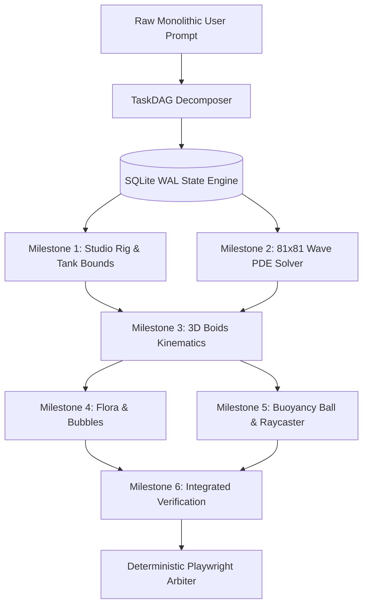

# TEST PLAN: HIERARCHICAL PROMPT DECOMPOSITION & DAG TRACKING
## Monolithic Prompt Slicing, SQLite WAL TaskDAG Scheduling, AST Symbol Indexing & State Persistence

> **Document ID**: `Desktop/hermes/roadmap3/02_HIERARCHICAL_PROMPT_DECOMPOSITION_AND_DAG_TRACKING_PLAN.md`  
> **Target Subsystem**: TaskDAG Decomposition Engine (`src/hermes_core/task_graph.py`), Symbol Graph (`symbol_graph.py`), & State Engine  
> **Prerequisites**: Roadmap 2 (U21, U22, U25, U32, U33)  
> **Verification Standard**: SQLite WAL Transactional Consistency, Kahn Topological Order, & Sub-350 Token Scratchpads

---

## 1. The Prompt Spectrum & Decomposition Taxonomy

Local 4B models suffer severe **Attention Diffusion** and code dropouts when attempting to synthesize complex multi-subsystem applications in a single prompt. The single Hermes binary must classify incoming prompts along a 4-tier spectrum and execute appropriate hierarchical decomposition:

```
┌────────────────────────────────────────────────────────────────────────────────────────────────────────┐
│                                 THE 4-TIER PROMPT DECOMPOSITION SPECTRUM                               │
├─────────┬──────────────────────────┬─────────────────────────────┬─────────────────────────────────────┤
│ Level   │ Prompt Scope & Nature    │ Hermes Autonomous Strategy  │ Context & Execution Boundary        │
├─────────┼──────────────────────────┼─────────────────────────────┼─────────────────────────────────────┤
│ Level 1 │ Atomic Micro-Task        │ Direct Fast-Path Execution  │ Single turn (<20s), surgical patch, │
│         │ (e.g. "Fix typo in L42") │ (No DAG decomposition)      │ zero scratchpad overhead.           │
├─────────┼──────────────────────────┼─────────────────────────────┼─────────────────────────────────────┤
│ Level 2 │ Component Enhancement    │ 2-Step Plan & Implement     │ Turn 1: Symbol outline & plan;      │
│         │ (e.g. "Add TTL caching") │ (In-memory verification)    │ Turn 2: Micro-patch + AST check.    │
├─────────┼──────────────────────────┼─────────────────────────────┼─────────────────────────────────────┤
│ Level 3 │ Monolithic Project       │ Full SQLite WAL TaskDAG     │ 3–6 topological milestones;         │
│         │ (e.g. "Build WebGL Sim") │ (Kahn topological sort)     │ Fresh subagent scratchpads (<350 t).│
├─────────┼──────────────────────────┼─────────────────────────────┼─────────────────────────────────────┤
│ Level 4 │ Ambiguous / Vague Spec   │ Epistemic Research + DAG    │ Web research + repo AST onboard;    │
│         │ (e.g. "Speed up repo")   │ (Synthesizes exact bounds)  │ Interactive supervisory checkpoint. │
└─────────┴──────────────────────────┴─────────────────────────────┴─────────────────────────────────────┘
```

---

## 2. Topological TaskDAG Decomposition Architecture (U21 Standard)

When a Level 3 or Level 4 prompt is received, Hermes automatically constructs a Directed Acyclic Graph (DAG) stored in SQLite with WAL mode (`state.db` / `task_graph.db`).



### 2.1 Core DAG Operational Invariants
1. **Topological Order Execution**: Nodes with in-degree 0 (unblocked dependencies) are executed first using Kahn's algorithm.
2. **Cycle Rejection**: Any circular dependency between milestones throws `CycleDetectedError` immediately during graph construction.
3. **Retry Exhaustion Policy**: Each node allows up to 3 repair attempts. If exhausted, the node transitions to `FAILED`, triggering ancestor git rollback and branch swapping.
4. **Context Isolation**: Each milestone executes inside an ephemeral, fresh subagent scratchpad ($\le 350\text{ tokens}$). Only the verified artifact and structured interface definitions are emitted back to global state.

---

## 3. Comprehensive DAG & State Tracking Test Suites

### Test Suite TC-DAG-01: Linear Pipeline Decomposition (3-Step Sequence)
* **Objective**: Verify that a multi-phase task is correctly decomposed into a sequential pipeline:
  $$\text{Task A (Data Model)} \longrightarrow \text{Task B (Service Logic)} \longrightarrow \text{Task C (Unit Tests)}$$
* **Test Case Steps**:
  1. Initialize `TaskDAG` with 3 sequential tasks.
  2. Query `get_ready_tasks()`: Assert only Task A is ready.
  3. Mark Task A `COMPLETED`: Assert Task B becomes ready.
  4. Mark Task B `COMPLETED`: Assert Task C becomes ready.
  5. Mark Task C `COMPLETED`: Assert `is_complete() == True`.
* **Pass Criteria**: Exact topological progression verified; zero out-of-order executions.

### Test Suite TC-DAG-02: Diamond Dependency Resolution
* **Objective**: Verify that parallel branches execute independently and merge cleanly into a shared dependency:
  $$\text{Task A} \longrightarrow \{\text{Task B}, \text{Task C}\} \longrightarrow \text{Task D}$$
* **Test Case Steps**:
  1. Complete Task A: Assert both Task B and Task C are returned in `get_ready_tasks()`.
  2. Complete Task B: Assert Task D is NOT ready (Task C still pending).
  3. Complete Task C: Assert Task D is now ready.
* **Pass Criteria**: Task D unblocks if and only if BOTH Task B and Task C are completed.

### Test Suite TC-DAG-03: Cycle Detection & Rejection
* **Objective**: Verify that circular dependency injection is detected and blocked with zero database corruption:
  $$\text{Task A} \longrightarrow \text{Task B} \longrightarrow \text{Task C} \longrightarrow \text{Task A}$$
* **Test Case Steps**:
  1. Construct a 3-node cyclic graph in `TaskDAG`.
  2. Assert `validate_dag()` raises `CycleDetectedError`.
* **Pass Criteria**: Database rolls back cleanly; no invalid DAG state persisted.

### Test Suite TC-DAG-04: Retry Exhaustion & Ancestor Lineage Rollback (U17)
* **Objective**: Verify that when a sub-task fails 3 consecutive repair attempts, the harness halts the branch and rolls back to the last known good ancestor snapshot.
* **Test Case Steps**:
  1. Complete Milestone 1 (Snapshot saved: `snap_m1`).
  2. Execute Milestone 2: Inject intentional failing syntax.
  3. Attempt Turn 1, 2, 3: All fail invariant checks.
  4. Assert Milestone 2 marked `FAILED`; Supervisor triggers `ROLLBACK_TO_ANCESTOR(snap_m1)`.
* **Pass Criteria**: Working directory restored to clean `snap_m1` state; failed branch pruned from active DAG.

### Test Suite TC-DAG-05: SQLite WAL Persistence & Crash Recovery
* **Objective**: Verify that task states, edge dependencies, and snapshot hashes survive sudden process termination.
* **Test Case Steps**:
  1. Populate 5-node `TaskDAG` in `/dev/shm/test_task_graph.db`.
  2. Complete 2 nodes; record database SHA-256 hash.
  3. Send `SIGKILL` to Python process.
  4. Re-instantiate `TaskDAG` from same database file in a new process.
  5. Assert completed nodes remain `COMPLETED`, ready node is identical, and zero WAL corruption exists.
* **Pass Criteria**: 100% state recovery after ungraceful termination.

---

## 4. AST Symbol Knowledge Graph & Working Memory Integration (U22 & U32)

### 4.1 Whole-Repo AST Graph Indexing (`symbol_graph.py`)
Hermes indexes codebase structure into a local SQLite table (`symbols`, `symbol_references`):

```
┌────────────────────────────────────────────────────────────────────────────────────────────────────────┐
│                              AST SYMBOL KNOWLEDGE GRAPH CAPABILITIES                                  │
├────────────────────────────────┬───────────────────────────────────────────────────────────────────────┤
│ Query Method                   │ Description & Latency Budget                                          │
├────────────────────────────────┼───────────────────────────────────────────────────────────────────────┤
│ `get_file_outline(path)`       │ Hierarchical classes, methods, and functions (<0.5ms latency).        │
│ `get_callers(symbol_name)`     │ Bidirectional call hierarchy resolution across all files (<2ms).      │
│ `get_callees(symbol_name)`     │ Functions and methods called by the target symbol (<2ms).             │
│ `get_inheritance_tree(class)`  │ Subclass/superclass hierarchy resolution (<1ms).                      │
│ `index_directory(path)`        │ Recursive AST extraction with gitignore filtering (<500ms for 50 files│
└────────────────────────────────┴───────────────────────────────────────────────────────────────────────┘
```

### 4.2 Dynamic Working Memory & Experience Injection (U32 Standard)
Dynamic context is strictly injected at the **tail of the latest user turn** to preserve 100% KV prefix cache hits on `llama-server`:

```
[SYSTEM PROMPT - 100% BYTE-STATIC PREFIX]
  ├── Mythos Cognitive Governor Law Block (<60 tokens)
  └── Role Instructions & Static Tools Schema (<350 tokens)

[CONVERSATION HISTORY]
  ├── User Turn 1
  └── Assistant Turn 1 ...

[LATEST USER TURN + DYNAMIC TAIL INJECTION]
  ├── User Prompt Text
  ├── WorkingMemoryAnchor (Active Milestone, Pinned Symbols, Spatial Contracts)
  └── ExperienceStore (Accumulated Negative Constraints & Positive Playbooks)
```

---

## 5. Pass/Fail Evaluation Criteria

A test run of the Hierarchical Prompt Decomposition & DAG Tracking Suite passes if and only if:
1. **Decomposition Precision**: Monolithic prompts are cleanly decomposed into 3–6 non-overlapping topological milestones with deterministic verification criteria.
2. **Kahn Scheduler Reliability**: 100% of DAG executions follow valid topological ordering with zero race conditions.
3. **Transaction Latency**: SQLite WAL database reads/writes complete in $\le 5\text{ms}$ on RAMDisk.
4. **Context Bounding**: 100% of subagent scratchpads maintain $\le 350\text{ token}$ system prompts and $\le 2,048\text{ token}$ working histories.
