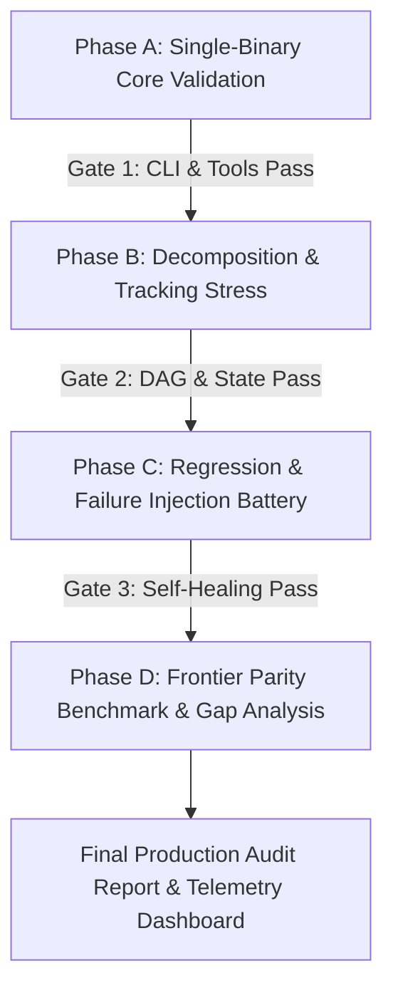

# MASTER TEST PLAN: AUTONOMOUS SINGLE-BINARY HERMES
## Verification of Standalone Agent OS Execution, Hierarchical Prompt Decomposition & Production Parity

> **Document ID**: `Desktop/hermes/roadmap3/00_MASTER_HERMES_AUTONOMOUS_TEST_PLAN.md`  
> **Target Execution**: Single Standalone Binary (`hermes <prompt>` / `hermes run "<prompt>"` / `hermes -z --yolo "<prompt>"`)  
> **Context**: Post-Roadmap 1 (U1–U20) & Post-Roadmap 2 (U21–U35) Production Graduation  
> **Hardware Baseline**: Single Local GPU (NVIDIA RTX 3050 Laptop / 4GB VRAM / CC 8.6) + `ws-ai` Distrobox Substrate  
> **Inference Engine**: Local 4B SLMs (Gemma-4-E4B-it / Qwen-3.6-4B-it) with MTP Speculative Decoding on `:8138` (58–70 tok/s)

---

## 1. Executive Summary & The Autonomous Convergence Thesis

### 1.1 The Journey: Why We Built Roadmaps 1 & 2
Throughout the early research tiers, our workspace relied on external multi-process orchestrator scripts (`bin/run_multibot_team.py` and `bin/run_multibot_astra.py`). While these scripts proved the theoretical validity of the 3-bot division (`@architect` ➔ `@coder` ➔ `@tester`), they functioned as an external "crutch" or harness scaffold rather than a unified production tool.

To graduate to a true **Autonomous Agent OS**, we executed two complete evolutionary roadmaps:
- **Roadmap 1 (Living Harness Primitives, `U1`–`U20`)**: Established Bubblewrap kernel sandboxing (`sandbox.py`), POSIX PGID sub-15ms process guards (`process_guard.py`), byte-static prefix cache alignment (`prefix_cache.py`), Karpathy surgical code rules (`hooks.py`), Codex differential token economy (`token_engine.py`), and SHA-256 hash-chained trajectory streams (`trajectory.py`).
- **Roadmap 2 (Autonomous Agent OS & Metacognitive Loop, `U21`–`U35`)**: Established SQLite WAL task DAGs (`task_graph.py`), whole-repo AST symbol knowledge graphs (`symbol_graph.py`), sub-300ms fast web research (`fast_research.py`), binary security CTF tools (`security_ctf.py`), 0 MB VRAM CPU neural embeddings (`embeddings.py`), two-tier JIT skills catalog (`skills_catalog.py`), supervisory HITL gateways (`hitl_gateway.py`), repo onboarders (`repo_onboard.py`), live LSP bridge (`lsp_bridge.py`), Google Env-Harness genetic evolution (`harness_evolution.py`), 5-pillar skill evaluators (`skill_evaluator.py`), RAMDisk episodic experience store (`experience_store.py`), 7-layer Agent OS daemon (`agent_os.py`), Prime Python kernel (`prime_kernel.py`), and continual post-turn refine loops (`continual_refine.py`).

### 1.2 The Production Objective: Testing Hermes as a Single Standalone Binary
The dependency on `multibot.py` is now removed. The sole objective of **Roadmap 3** is to rigorously test and evaluate **Hermes as a single unified binary** (`~/.local/bin/hermes` / `hermes_harness/cli.py`):

$$\text{User Invocation: } \texttt{hermes "Decompose, implement, and verify this system"}$$

This test plan defines how to measure whether Hermes operates with the same autonomy, robustness, context discipline, and surgical execution quality as industry benchmarks: **Google Antigravity CLI**, **OpenAI Codex CLI**, and **Anthropic Claude Code**.

```
┌────────────────────────────────────────────────────────────────────────────────────────────────────────┐
│                               MASTER TEST ARCHITECTURE: THE 6 TEST PILLARS                             │
├────────────────────────────────┬───────────────────────────────┬───────────────────────────────────────┤
│ Pillar 1: Single-Binary CLI    │ Pillar 2: Tool Calling Loop   │ Pillar 3: Prompt Decomposition        │
│ • Direct CLI command dispatch  │ • Autonomous tool selection   │ • Monolithic prompt slicing           │
│ • Headless & YOLO execution    │ • Dynamic JSON Schema masking │ • SQLite WAL TaskDAG creation         │
│ • Subcommand interfaces        │ • Code Mode SDK fast-path     │ • AST symbol graph dependency map     │
│ • Sub-25s turnaround budget    │ • Sub-15ms sandbox isolation  │ • Sub-350 tok atomic scratchpads      │
├────────────────────────────────┼───────────────────────────────┼───────────────────────────────────────┤
│ Pillar 4: State & Memory       │ Pillar 5: Regression & Gates  │ Pillar 6: Frontier Parity             │
│ • SQLite WAL transactional log │ • Duplicate declaration trap  │ • Antigravity CLI side-by-side        │
│ • RAMDisk episodic store       │ • Context compaction freeze   │ • OpenAI Codex CLI parity             │
│ • SHA-256 trajectory stream    │ • Tool loop circuit breaker   │ • Anthropic Claude Code parity        │
│ • Ancestor lineage rollback    │ • Observer Gate pre-commit    │ • 10-Task SWE engineering suite       │
└────────────────────────────────┴───────────────────────────────┴───────────────────────────────────────┘
```

---

## 2. The Core Definition of "Working Like Antigravity / Codex"

To evaluate Hermes objectively, we define the non-negotiable operational behaviors that characterize frontier coding assistants:

| Operational Dimension | Antigravity / Codex Standard | Hermes Single-Binary Target | Failure Indicator (Bug/Regression) |
| :--- | :--- | :--- | :--- |
| **1. Autonomous Epistemic Sequence** | Never writes code blindly. Gathers information (`read`, `grep`, `symbols`) before mutating files. | Reads target files and queries AST symbol index before emitting diffs. | Emits speculative `write_file` overwriting existing modules without reading them. |
| **2. Hierarchical Planning** | Monolithic user prompts are silently decomposed into an internal step-by-step DAG. | Builds in-memory/SQLite `TaskDAG` with explicit milestone verification criteria. | Attempts to generate 800+ lines of multi-subsystem code in a single prompt turn. |
| **3. Context Compaction & Health** | Maintains tight, token-bounded context; never locks on massive conversational dumps. | Operates in ephemeral scratchpads (<350 tokens) with byte-static prefix cache hits. | Session message count exceeds 25 turns, triggering 4B GPU context compaction freeze. |
| **4. Surgical Patching** | Uses line-anchored search-and-replace diffs with uniqueness guarantees. | Uses AST-aware micro-patching; single-namespace state containers (`const APP = {}`). | Causes `SyntaxError: Identifier 'x' has already been declared` or broken closing braces. |
| **5. Deterministic Arbiter (Zero-Sorry)** | Never self-grades. Runs external linters, compilers, and test suites. | Invokes Playwright, Pytest, Pyright LSP, and `observer_gate.py` to verify claims. | LLM outputs "Everything is implemented and works perfectly!" without running a single test. |
| **6. Metacognitive Self-Healing** | Diagnostic error traces are automatically sieved and fed back into surgical repair turns. | Sieves error traces (<80 tokens) and applies targeted fixes within 3 turns. | Loops endlessly on the same broken tool call or repeats already-failed approaches. |

---

## 3. Production Readiness Index (PRI) Scoring Rubric

To calculate our genuine standing in production, every test run computes a composite score across 6 core sub-indices (Total: 100 Points):

$$\text{PRI} = S_{\text{CLI}} (15) + S_{\text{Tools}} (20) + S_{\text{Decomp}} (20) + S_{\text{State}} (15) + S_{\text{Safety}} (15) + S_{\text{Parity}} (15)$$

```
┌────────────────────────────────────────────────────────────────────────────────────────────────────────┐
│                               PRODUCTION READINESS INDEX (PRI) WEIGHTS                                │
├──────────────────────────────────────────────────────┬─────────────────────────────────────────────────┤
│ Sub-Index                                            │ Maximum Points & Pass Criteria                  │
├──────────────────────────────────────────────────────┼─────────────────────────────────────────────────┤
│ 1. Single-Binary CLI & Invocation ($S_{\text{CLI}}$) │ 15 Pts: Clean exit codes, sub-25s turn, YOLO mode│
│ 2. Autonomous Tool Calling ($S_{\text{Tools}}$)       │ 20 Pts: 100% schema match, zero syntax drops    │
│ 3. Hierarchical Decomposition ($S_{\text{Decomp}}$)  │ 20 Pts: Monolithic prompt ➔ DAG, <350 tok turns │
│ 4. State & Trajectory Tracking ($S_{\text{State}}$)  │ 15 Pts: SQLite WAL intact, zero RAMDisk loss     │
│ 5. Failure Resistance & Safety ($S_{\text{Safety}}$) │ 15 Pts: Observer Gate active, zero VRAM spikes   │
│ 6. Frontier Parity Benchmark ($S_{\text{Parity}}$)   │ 15 Pts: ≥80% pass on standardized SWE tasks      │
├──────────────────────────────────────────────────────┴─────────────────────────────────────────────────┤
│ Target Production Threshold: ≥ 85 / 100 (APPROVED FOR UNATTENDED PRODUCTION USE)                      │
└────────────────────────────────────────────────────────────────────────────────────────────────────────┘
```

---

## 4. Master Test Execution Plan Lifecycle

The overall test plan is structured into 4 sequential execution phases:



### Phase A: Single-Binary Invocation & Tool Calling Integrity
- Tests direct CLI execution (`hermes "<prompt>"`), argument parsing, profile selection, sandbox isolation, and dynamic tool schema generation.
- *Detailed Plan*: See [`01_SINGLE_BINARY_INVOCATION_AND_TOOL_CALLING_MATRIX.md`](file:///var/home/imshubhamsocial/Desktop/hermes/roadmap3/01_SINGLE_BINARY_INVOCATION_AND_TOOL_CALLING_MATRIX.md).

### Phase B: Hierarchical Prompt Decomposition & State Tracking
- Tests how Hermes handles short, medium, long, and ambiguous prompts; verifies automatic TaskDAG generation, AST symbol graph queries, and SQLite persistence.
- *Detailed Plan*: See [`02_HIERARCHICAL_PROMPT_DECOMPOSITION_AND_DAG_TRACKING_PLAN.md`](file:///var/home/imshubhamsocial/Desktop/hermes/roadmap3/02_HIERARCHICAL_PROMPT_DECOMPOSITION_AND_DAG_TRACKING_PLAN.md).

### Phase C: Historical Regression & Failure Mode Injection
- Injects 8 known failure modes (duplicate declarations, compaction locks, tool loop stalls, markdown fence escapes, VRAM spikes) and verifies active guardrails.
- *Detailed Plan*: See [`03_FAILURE_MODES_REGRESSIONS_AND_EDGE_CASE_TEST_SUITE.md`](file:///var/home/imshubhamsocial/Desktop/hermes/roadmap3/03_FAILURE_MODES_REGRESSIONS_AND_EDGE_CASE_TEST_SUITE.md).

### Phase D: Frontier Parity Benchmark & Production Gap Analysis
- Benchmarks Hermes against Antigravity CLI, OpenAI Codex CLI, and Claude Code across 10 standardized real-world engineering tasks.
- *Detailed Plan*: See [`04_ANTIGRAVITY_CODEX_CLAUDE_PARITY_BENCHMARK_SPEC.md`](file:///var/home/imshubhamsocial/Desktop/hermes/roadmap3/04_ANTIGRAVITY_CODEX_CLAUDE_PARITY_BENCHMARK_SPEC.md) and [`06_PRODUCTION_GAP_ANALYSIS_AND_ROADMAP3_RECOMMENDATIONS.md`](file:///var/home/imshubhamsocial/Desktop/hermes/roadmap3/06_PRODUCTION_GAP_ANALYSIS_AND_ROADMAP3_RECOMMENDATIONS.md).

---

## 5. Non-Negotiable Invariant Verification Laws

1. **Deterministic Test Arbiter (Zero-Sorry)**: No human or LLM opinion may certify a test as passed. Every pass claim must cite exact machine-verifiable exit codes, AST validator outputs, and Playwright/pytest results.
2. **Hardware Envelope Protection**: Total GPU VRAM consumption must remain $\le 3,800\text{ MiB}$ at all times on the local RTX 3050 (4GB). CPU neural embeddings and RAMDisk databases must consume 0 MB GPU VRAM.
3. **Btrfs Zero-Wear Storage**: All ephemeral logs, SQLite test databases, and trajectory streams must reside on `/dev/shm` (RAMDisk) or have `chattr +C` (NOCOW) attributes to prevent NVMe wear and Btrfs metadata fragmentation.
4. **Epistemic Bounded Turns**: Individual agent execution turns must remain bounded ($\le 350\text{ tokens}$ per scratchpad turn, $\le 25\text{s}$ per turn).
