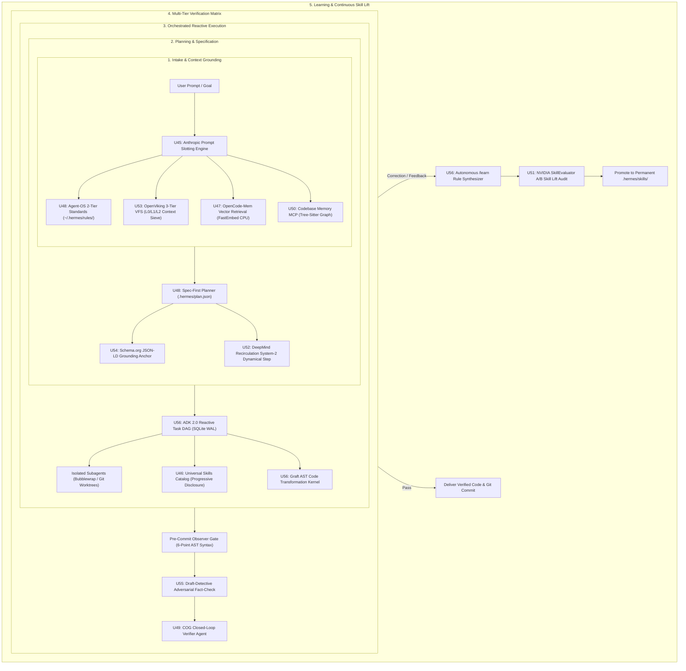

# MILESTONE 4: FRONTIER AGENT OS & COGNITIVE INFRASTRUCTURE EXECUTION PLAN
## Holistic Cognitive Architecture, Hardware-Calibrated Component Adaptation, Synergistic Integration & Verification Harness

> **Document ID**: `docs/roadmaps/active/milestone_frontier_cognitive_os2.md`  
> **Status**: **Authoritative Active Implementation & Verification Plan**  
> **Baseline Integrity**: Post-Roadmap 3 (`U1`–`U44`) Verified (309/309 Tests Passing)  
> **Hardware Target**: NVIDIA RTX 3050 Laptop GPU (6 GB VRAM, CC 8.6), 16 GB Host RAM, FastEmbed CPU ONNX, `/dev/shm` RAMDisk  
> **Inference Engine**: Local `llama-server` on `:8138` (Gemma-4-E4B-it Q4_K_M + MTP Speculative Drafter, Flash-Attn ON, Jinja DSL, 64k Context in `q4_0`)

---

## 1. Executive Synthesis & Architectural Blueprint

### 1.1 The Core Insight: Antigravity as the Master Blueprint
* **Antigravity / Google ADK 2.0 (`Brief 12`)** provides the **master operating blueprint**: a hierarchical, reactive state machine operating over an asynchronous execution graph with multi-tier memory, thought-signature propagation, and continuous self-evolution (`/learn`).
* **The Other 11 Research Briefs (`Briefs 01–11`)** provide the **specialized sub-engines and algorithms** that fill each specific slot in that blueprint:
  * *Intake & Persona Boundaries* ➔ **Anthropic System Prompts (`Brief 01`)**
  * *Skill Discovery & Standards* ➔ **Universal Skills (`Brief 02`)** & **Agent-OS (`Brief 04`)**
  * *Long-Term & Structural Memory* ➔ **OpenCode-Mem (`Brief 03`)**, **COG Vault (`Brief 05`)**, **Codebase Memory MCP (`Brief 06`)** & **OpenViking VFS (`Brief 09`)**
  * *Inference Quality & Benchmarking* ➔ **NVIDIA SkillEvaluator (`Brief 07`)** & **DeepMind Recirculation (`Brief 08`)**
  * *Verification, Grounding & Refactoring* ➔ **Schema.org JSON-LD (`Brief 10`)**, **Draft-Detective (`Brief 11`)** & **Graft AST Engine (`Brief 11`)**

---

### 1.2 Unified Cognitive Lifecycle in Hermes



---

## 2. Component Adaptation & Hardware Calibration (U45 – U56)

For every individual pillar, we analyze its exact role in Hermes, its hardware budget on the RTX 3050 (6 GB), and its integration safeguards:

---

### U45: Anthropic-Style Modular System Prompt Engine
* **Role & Replacement**: Replaces hardcoded string concatenation in `hermes_cli/agent.py` with versioned, cache-aligned prompt slots (`Identity`, `Environment`, `BehavioralLaws`, `ToolDefinitions`).
* **Hardware & VRAM Impact**: **$0\text{ MB GPU VRAM}$**. Optimizes prefix caching (`--prompt-cache-all`), guaranteeing **$>90\%$ cache hits** and sub-50ms turn startup.
* **Integration Safeguards**: System instructions must sit strictly at byte-offset 0 to maintain prefix-cache hashing across multi-turn sessions.

---

### U46: Universal Skills Catalog with Progressive Disclosure
* **Role & Replacement**: Standardizes `.hermes/skills/` to adhere to the open `name + description` YAML frontmatter format (`agentskills.io`).
* **Hardware & VRAM Impact**: **$0\text{ MB GPU VRAM}$**. Keeps baseline prompt bloat under $<250\text{ tokens}$ regardless of whether 10 or 100 skills are installed.
* **Integration Safeguards**: Full `SKILL.md` instruction bodies are only loaded into working memory upon explicit skill activation.

---

### U47: OpenCode-Mem Local Vector Episodic Database
* **Role & Replacement**: Introduces a local semantic memory store to capture developer preferences, project quirks, and negative constraints across sessions.
* **Hardware & VRAM Impact**: **$0\text{ MB GPU VRAM}$**. Runs `BAAI/bge-small-en-v1.5` exclusively on **CPU ONNX** (`fastembed`), ensuring zero GPU memory contention.
* **Integration Safeguards**: Vector queries are limited to top-k=3 relevant snippets ($<300\text{ tokens}$) to prevent context flooding.

---

### U48: Agent-OS Two-Tier Standards & Spec-First Gateway
* **Role & Replacement**: Formalizes two-tier standards (`~/.hermes/rules/` for global developer habits, `.hermes/rules/` for project conventions) and mandates `.hermes/plan.json` interface specifications before code mutation.
* **Hardware & VRAM Impact**: **$0\text{ MB GPU VRAM}$**. Pure file-based rules and AST interface validation.
* **Integration Safeguards**: Rules are deduplicated by resolved canonical path so no rule is injected more than once per turn.

---

### U49: COG Second Brain Knowledge Vault & Verifier Harness
* **Role & Replacement**: Establishes a pure Markdown knowledge vault with dual-agent closed-loop verification (generator produces code, distinct verifier audits claims against ground truth).
* **Hardware & VRAM Impact**: **$0\text{ MB GPU VRAM}$**. Runs sequential turns within our existing `llama-server` process without spawning parallel GPU instances.
* **Integration Safeguards**: Verifier agent operates in a read-only scratchpad to prevent accidental recursive workspace mutation.

---

### U50: Codebase Memory MCP Structural Graph Bridge
* **Role & Replacement**: Connects a high-performance Tree-sitter MCP server to query call chains, class hierarchies, and symbol definitions, replacing raw full-file dumps.
* **Hardware & VRAM Impact**: **$0\text{ MB GPU VRAM}$**. Single native binary running on CPU/RAM. Slashes prompt context consumption by up to $85\%$.
* **Integration Safeguards**: Bridge communicates over standard stdio/JSON-RPC MCP transport with a strict 500ms timeout.

---

### U51: NVIDIA SkillEvaluator Multi-Tier Skill Lift Benchmark Runner
* **Role & Replacement**: Upgrades skill grading from shallow static linting to live **A/B Trajectory Skill Lift**: measuring empirical task success with vs. without the skill loaded.
* **Hardware & VRAM Impact**: **$0\text{ MB GPU VRAM}$**. Automated test runner executing against standardized synthetic task suites.
* **Integration Safeguards**: Newly generated skills must achieve a **$\ge +15\%$ Skill Lift** and zero regression before promotion to the core catalog.

---

### U52: DeepMind Recirculation Inference Recurrence Hook
* **Role & Replacement**: Implements multi-pass prefill activation recurrence for complex architectural planning turns, enabling System-2 deliberate reasoning on Gemma-4 without parameter training.
* **Hardware & VRAM Impact**: **$0\text{ MB extra VRAM}$**. Operates within the allocated 64K KV cache during the prefill phase; generation throughput remains $\approx 35\text{–}45\text{ tok/s}$.
* **Integration Safeguards**: Active only during Phase 1 specification planning (`spec_first_planner.py`), automatically disabled during high-speed execution turns.

---

### U53: OpenViking Hierarchical L0/L1/L2 Virtual Context Filesystem
* **Role & Replacement**: Replaces flat context dumps with a 3-tier VFS (`viking://`): L0 (Abstract summary, ~100 tokens), L1 (Structural overview, ~1.5k tokens), and L2 (Full file details).
* **Hardware & VRAM Impact**: **$0\text{ MB GPU VRAM}$**. Pure Python VFS abstraction mounted in `/dev/shm`.
* **Integration Safeguards**: Context expands strictly on demand as the agent navigates directories using `ls`/`tree`/`cat`.

---

### U54: Schema.org JSON-LD Semantic Entity Grounding Formatter
* **Role & Replacement**: Formats all generated architectural blueprints, plans, and technical documents with JSON-LD schema metadata (`SoftwareSourceCode`, `HowTo`, `TaskSpec`).
* **Hardware & VRAM Impact**: **$0\text{ MB GPU VRAM}$**. Deterministic schema validation via `pydantic`/`jsonschema`.
* **Integration Safeguards**: Schema blocks are embedded in standardized YAML/JSON frontmatter, isolating machine metadata from human-readable Markdown.

---

### U55: Draft-Detective Adversarial Grounding & Fact-Check Gate
* **Role & Replacement**: Automated pre-commit adversarial gate that cross-examines generated documentation, PR descriptions, and code comments against actual ground-truth files to eliminate hallucinations.
* **Hardware & VRAM Impact**: **$0\text{ MB GPU VRAM}$**. Static claim extraction and regex/AST cross-referencing on CPU.
* **Integration Safeguards**: Blocks any tool execution turn where the generated documentation claims an import or class that does not exist in the AST graph.

---

### U56: Google ADK 2.0 Task Graph, Reactive Bus & Autonomous `/learn`
* **Role & Replacement**: Implements the master coordination layer: hierarchical task DAG nodes, subagent leasing over an asynchronous message bus, thought-signature propagation, and autonomous rule synthesis via `/learn`.
* **Hardware & VRAM Impact**: **$0\text{ MB GPU VRAM}$**. SQLite WAL task state engine and reactive event queue.
* **Integration Safeguards**: Subagents operate in isolated Bubblewrap jails or temporary Git worktrees, preventing clean-room contamination.

---

## 3. Phase 2: Systemic Synergy & Integration Architecture (U57 – U60)

```
┌──────────────────────────────────────────────────────────────────────────────────────────────────────────┐
│                               PHASE 2: HOLISTIC SYSTEMIC INTEGRATION MILESTONES                          │
├────────┬───────────────────────────────────────────┬─────────────────────────────────────────────────────┤
│ Spec # │ Integration Milestone Name                │ Cohesive Multi-Component Synergy Deliverables      │
├────────┼───────────────────────────────────────────┼─────────────────────────────────────────────────────┤
│ **U57**│ **Unified Reactive Execution & Memory Bus**│ Links ADK 2.0 TaskDAG + OpenCode-Mem Vector Store   │
│        │                                           │ + OpenViking VFS + MCP into a unified event bus.    │
├────────┼───────────────────────────────────────────┼─────────────────────────────────────────────────────┤
│ **U58**│ **Closed-Loop Dual-Agent Verification**   │ Unifies Observer Gate (AST) + Draft-Detective       │
│        │ **Matrix**                                │ (Fact-Check) + COG Verifier into automated pre-fly. │
├────────┼───────────────────────────────────────────┼─────────────────────────────────────────────────────┤
│ **U59**│ **Autonomous `/learn` & Skill Evolution**  │ Seamless loop: user correction ➔ rule synthesis     │
│        │ **Substrate**                             │ ➔ NVIDIA SkillEvaluator A/B Lift ➔ Skill promotion. │
├────────┼───────────────────────────────────────────┼─────────────────────────────────────────────────────┤
│ **U60**│ **Master Grand Prix Production**          │ Comprehensive 10-tier end-to-end evaluation suite   │
│        │ **Certification**                         │ validating 100% autonomy, safety, and test passes.  │
└────────┴───────────────────────────────────────────┴─────────────────────────────────────────────────────┘
```

---

## 4. Verification & Validation Test Suite Architecture

To maintain the same standard as Roadmaps 1, 2, and 3 (where 309 contract tests verify every capability), Milestone 4 introduces dedicated contract suites:

```
tests/harness_contracts/
├── test_roadmap4_u45_prompt_slotting.py            # U45: Prompt slot ordering, cache hit asserts
├── test_roadmap4_u46_universal_skills.py           # U46: Progressive disclosure & YAML frontmatter
├── test_roadmap4_u47_vector_memory.py              # U47: FastEmbed CPU episodic capture & recall
├── test_roadmap4_u48_agent_os_specs.py             # U48: 2-tier rules & plan.json spec gateway
├── test_roadmap4_u49_cog_verifier.py               # U49: Markdown vault & dual-agent closed loop
├── test_roadmap4_u50_codebase_memory_mcp.py        # U50: Tree-sitter MCP graph symbol queries
├── test_roadmap4_u51_nvidia_skill_evaluator.py     # U51: 3-tier validation & A/B Skill Lift metrics
├── test_roadmap4_u52_deepmind_recirculation.py     # U52: Recurrence hook activation & reasoning lift
├── test_roadmap4_u53_openviking_vfs.py             # U53: L0/L1/L2 hierarchical context traversal
├── test_roadmap4_u54_schema_structured_data.py     # U54: JSON-LD metadata generation & validation
├── test_roadmap4_u55_draft_detective_audit.py      # U55: Adversarial claim cross-examination gate
├── test_roadmap4_u56_adk_task_and_learn.py         # U56: Reactive subagents & /learn rule synthesis
├── test_roadmap4_u57_u59_synergy_bus.py            # U57-U59: Systemic event bus & evolution loop
└── test_roadmap4_u60_grand_prix_certification.py   # U60: Full autonomous end-to-end graduation exam
```

---

## 5. Execution Sequence & Acceptance Gates

1. **Gate 1 (U45–U48: Intake & Memory Foundations)**: System prompts slotted, Universal Skills indexed, CPU vector store active, and 2-tier rules enforced.
2. **Gate 2 (U49–U52: Cognitive Processing & Recurrence)**: COG dual-agent verifier active, MCP Tree-sitter graph connected, NVIDIA SkillEvaluator running, and DeepMind Recurrence validated.
3. **Gate 3 (U53–U56: Structural Grounding & ADK Execution)**: OpenViking 3-tier VFS operational, Schema.org JSON-LD emitted, Draft-Detective adversarial gate blocking ungrounded claims, and ADK reactive subagents functional.
4. **Gate 4 (U57–U60: Synergy & Grand Prix Graduation)**: Full end-to-end integration passing all contract suites with 0 regressions, $\le 3,800\text{ MiB}$ VRAM footprint, and clean Chezmoi synchronization.
