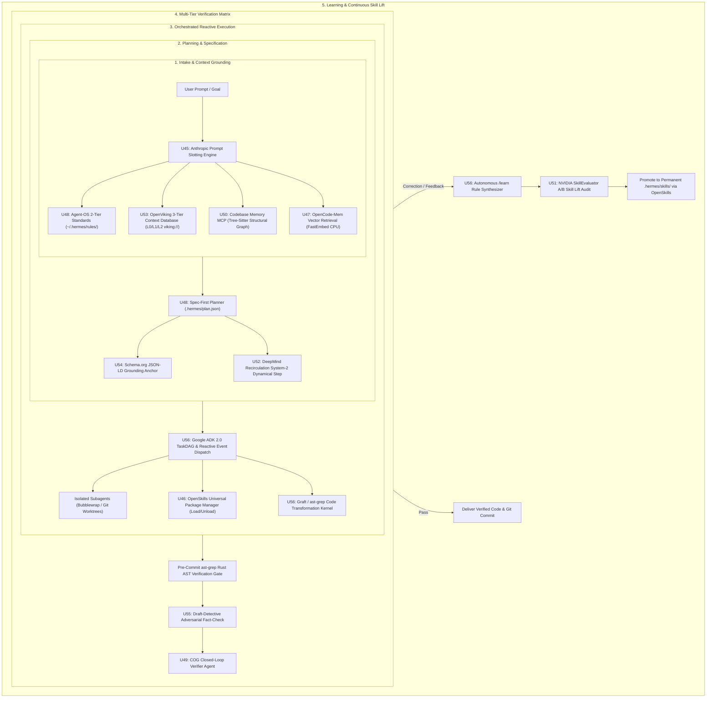

# ROADMAP 4: FRONTIER AGENT OS & COGNITIVE INFRASTRUCTURE EXECUTION PLAN
## Holistic Cognitive Architecture, Concrete Open-Source Tool Integration, Synergistic Execution & Verification Harness

> **Document ID**: `docs/roadmaps/active/roadmap4_frontier_cognitive_os.md`  
> **Status**: **Authoritative Active Implementation & Verification Plan**  
> **Baseline Integrity**: Post-Roadmap 3 (`U1`–`U44`) Verified (309/309 Tests Passing)  
> **Hardware Target**: NVIDIA RTX 3050 Laptop GPU (6 GB VRAM, CC 8.6), 16 GB Host RAM, FastEmbed CPU ONNX, `/dev/shm` RAMDisk  
> **Inference Engine**: Local `llama-server` on `:8138` (Gemma-4-E4B-it Q4_K_M + MTP Speculative Drafter, Flash-Attn ON, Jinja DSL, 64k Context in `q4_0`)

---

## 1. Executive Synthesis & Master Blueprint

### 1.1 The Core Architecture: Google Antigravity & ADK 2.0 as the Master Blueprint
* **Google Antigravity & ADK 2.0 (`Brief 12`)** provides the **master operating blueprint**: a hierarchical, reactive state machine operating over an asynchronous execution graph with multi-tier memory, thought-signature propagation, and continuous self-evolution (`/learn`).
* **The Specialized Open-Source Tools & Engines (`Briefs 01–11, 13`)** provide the **concrete, battle-tested implementations** that fill each specific slot in that blueprint without ad-hoc custom script bloat:
  * *Intake & Persona Boundaries* ➔ **Anthropic System Prompts (`Brief 01`)**
  * *Skill Package Management & Lifecycle* ➔ **OpenSkills (`Brief 13`)** & **Universal Skills (`Brief 02`)**
  * *Context Database & Long-Term Memory* ➔ **OpenViking VFS (`Brief 09/13`)** & **OpenCode-Mem (`Brief 03`)**
  * *Code Structural Knowledge Graph* ➔ **Codebase Memory MCP (`Brief 06`)** (Tree-sitter)
  * *Coding Standards & Two-Tier Rules* ➔ **Agent-OS (`Brief 04`)** & **COG Vault (`Brief 05`)**
  * *Inference Quality & Benchmarking* ➔ **NVIDIA SkillEvaluator (`Brief 07`)** & **DeepMind Recirculation (`Brief 08`)**
  * *Verification & AST Gating* ➔ **`ast-grep` / Draft-Detective (`Brief 11`)** & **Schema.org JSON-LD (`Brief 10`)**

---

### 1.2 Unified Cognitive Lifecycle in Hermes



---

## 2. Phase 1: Concrete Component-by-Component Adaptation Matrix (U45 – U56)

```
┌───────────────────────────────────────────────────────────────────────────────────────────────────────────┐
│                               PHASE 1: CONCRETE COMPONENT INTEGRATION MATRIX                              │
├────────┬────────────────────────────────────────┬─────────────────────────────────────────────────────────┤
│ Spec # │ Concrete Open-Source Tool / Technique  │ Hermes Implementation & Script Replacement Strategy     │
├────────┼────────────────────────────────────────┼─────────────────────────────────────────────────────────┤
│ **U45**│ **Anthropic Prompt Slotting** &        │ Replaces monolithic prompt builder with cache-aligned   │
│        │ **Perplexity Context Compactor**       │ slots and an automated $<4\text{k}$ turn compactor.     │
├────────┼────────────────────────────────────────┼─────────────────────────────────────────────────────────┤
│ **U46**│ **OpenSkills Package Manager**         │ Replaces ad-hoc `bin/skills_catalog.py` with standard   │
│        │ (`numman-ali/openskills`)              │ `openskills` universal loader (Load/Execute/Unload).    │
├────────┼────────────────────────────────────────┼─────────────────────────────────────────────────────────┤
│ **U47**│ **OpenCode-Mem Local Vector Engine**   │ CPU-based FastEmbed memory capturing cross-session      │
│        │ (`tickernelz/opencode-mem`)            │ negative constraints and project conventions.           │
├────────┼────────────────────────────────────────┼─────────────────────────────────────────────────────────┤
│ **U48**│ **Agent-OS Two-Tier Standards**        │ Formalizes global (`~/.hermes/rules/`) vs project       │
│        │ (`buildermethods/agent-os`)            │ standards and enforces pre-implementation `plan.json`.  │
├────────┼────────────────────────────────────────┼─────────────────────────────────────────────────────────┤
│ **U49**│ **COG Second Brain Markdown Vault**    │ Pure Markdown persistence with closed-loop dual-agent   │
│        │ (`huytieu/COG-second-brain`)           │ worker/verifier audit gates.                            │
├────────┼────────────────────────────────────────┼─────────────────────────────────────────────────────────┤
│ **U50**│ **Codebase Memory MCP** (Tree-sitter)  │ Replaces raw whole-file dumping with sub-millisecond    │
│        │ (`DeusData/codebase-memory-mcp`)       │ structural AST symbol and call-graph queries.           │
├────────┼────────────────────────────────────────┼─────────────────────────────────────────────────────────┤
│ **U51**│ **NVIDIA SkillEvaluator Benchmark**    │ Replaces static regex linting with live A/B Trajectory  │
│        │ (`NVIDIA/SkillEvaluator`)              │ Skill Lift benchmarking ($\ge +15\%$ certification).    │
├────────┼────────────────────────────────────────┼─────────────────────────────────────────────────────────┤
│ **U52**│ **DeepMind Recirculation Engine**      │ Prefill activation recurrence hook for Gemma-4 to boost │
│        │ (`arxiv:2608.17981`)                   │ System-2 planning reasoning without parameter training. │
├────────┼────────────────────────────────────────┼─────────────────────────────────────────────────────────┤
│ **U53**│ **OpenViking Context Database**        │ Multi-tier virtual filesystem (`viking://`) managing    │
│        │ (`volcengine/OpenViking`)              │ L0 (Abstract), L1 (Overview), and L2 (Full) context.    │
├────────┼────────────────────────────────────────┼─────────────────────────────────────────────────────────┤
│ **U54**│ **Schema.org JSON-LD Formatter**       │ Embeds deterministic entity metadata and machine-       │
│        │ (`schema.org` / Semrush)               │ readable anchors in all generated architectural plans.  │
├────────┼────────────────────────────────────────┼─────────────────────────────────────────────────────────┤
│ **U55**│ **ast-grep & Draft-Detective Gates**   │ Replaces ad-hoc `observer_gate.py` with native Rust     │
│        │ (`ast-grep` + `draft-detective`)       │ AST validation and adversarial fact-checking.           │
├────────┼────────────────────────────────────────┼─────────────────────────────────────────────────────────┤
│ **U56**│ **Google ADK 2.0 & /learn Substrate**  │ Master coordination: TaskDAG subagents, reactive bus,   │
│        │ (`google/adk-python`, `antigravity`)   │ thought signatures, and autonomous rule synthesis.      │
└────────┴────────────────────────────────────────┴─────────────────────────────────────────────────────────┘
```

---

## 3. Phase 2: Systemic Synergy & Holistic Architecture (U57 – U60)

```
┌──────────────────────────────────────────────────────────────────────────────────────────────────────────┐
│                               PHASE 2: HOLISTIC SYSTEMIC INTEGRATION MILESTONES                          │
├────────┬───────────────────────────────────────────┬─────────────────────────────────────────────────────┤
│ Spec # │ Integration Milestone Name                │ Cohesive Multi-Component Synergy Deliverables      │
├────────┼───────────────────────────────────────────┼─────────────────────────────────────────────────────┤
│ **U57**│ **Unified Reactive Execution & Memory Bus**│ Connects ADK 2.0 TaskDAG + OpenViking VFS +         │
│        │                                           │ OpenCode-Mem Vector Store + MCP into one event bus. │
├────────┼───────────────────────────────────────────┼─────────────────────────────────────────────────────┤
│ **U58**│ **Closed-Loop Dual-Agent Verification**   │ Links `ast-grep` (Rust AST) + Draft-Detective       │
│        │ **Matrix**                                │ (Fact-Check) + COG Verifier into pre-flight audit.  │
├────────┼───────────────────────────────────────────┼─────────────────────────────────────────────────────┤
│ **U59**│ **Autonomous `/learn` & Skill Evolution**  │ Autonomous user correction ➔ rule synthesis ➔       │
│        │ **Substrate**                             │ NVIDIA SkillEvaluator A/B Lift ➔ OpenSkills deploy. │
├────────┼───────────────────────────────────────────┼─────────────────────────────────────────────────────┤
│ **U60**│ **Master Grand Prix Production**          │ Comprehensive 10-tier end-to-end evaluation suite   │
│        │ **Certification**                         │ validating 100% autonomy, safety, and test passes.  │
└────────┴───────────────────────────────────────────┴─────────────────────────────────────────────────────┘
```

---

## 4. Verification & Validation Test Suite Architecture

```
tests/harness_contracts/
├── test_roadmap4_u45_prompt_slotting_and_compactor.py   # U45: Slot ordering & context compactor
├── test_roadmap4_u46_openskills_lifecycle.py            # U46: OpenSkills package load/execute/unload
├── test_roadmap4_u47_vector_memory.py                   # U47: FastEmbed CPU episodic capture & recall
├── test_roadmap4_u48_agent_os_specs.py                  # U48: 2-tier rules & plan.json spec gateway
├── test_roadmap4_u49_cog_verifier.py                    # U49: Markdown vault & dual-agent closed loop
├── test_roadmap4_u50_codebase_memory_mcp.py             # U50: Tree-sitter MCP graph symbol queries
├── test_roadmap4_u51_nvidia_skill_evaluator.py          # U51: 3-tier validation & A/B Skill Lift metrics
├── test_roadmap4_u52_deepmind_recirculation.py          # U52: Recurrence hook activation & reasoning lift
├── test_roadmap4_u53_openviking_context_vfs.py          # U53: OpenViking L0/L1/L2 context database
├── test_roadmap4_u54_schema_structured_data.py          # U54: JSON-LD metadata generation & validation
├── test_roadmap4_u55_ast_grep_and_draft_detective.py    # U55: Rust AST gate & adversarial fact-check
├── test_roadmap4_u56_adk_task_and_learn.py              # U56: Reactive subagents & /learn rule synthesis
├── test_roadmap4_u57_u59_synergy_bus.py                 # U57-U59: Systemic event bus & evolution loop
└── test_roadmap4_u60_grand_prix_certification.py        # U60: Full autonomous end-to-end graduation exam
```
