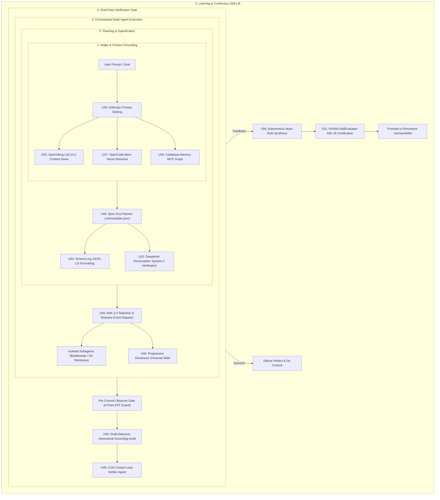

# ROADMAP 4: FRONTIER AGENT OS & COGNITIVE INFRASTRUCTURE SPECIFICATION
## Research Synthesis, Component Adaptation, and Full Systemic Synergy

> **Document ID**: `docs/roadmaps/active/roadmap4_frontier_cognitive_os.md`  
> **Status**: **Active Operational Roadmap**  
> **Preceding Baseline**: Roadmaps 1, 2, and 3 (`U1`–`U44`) Verified (309/309 Tests Passing)  
> **Scope**: Implementation & Integration Plan for the 12 Frontier Research Pillars into Hermes OS.

---

## 1. Executive Strategy & Two-Phase Architecture

Roadmap 4 transitions Hermes from a single-turn deterministic execution harness into a **frontier-grade, self-evolving, multi-agent cognitive operating system**. 

The roadmap is executed strictly in two sequential phases:
* **Phase 1: Component-Level Adaptation & Integration Analysis (U45–U56)**
  * For each of the 12 research briefs, analyze how the external mechanism maps into Hermes, identifying what it integrates with, improves, or completely replaces in our existing codebase.
* **Phase 2: Systemic Synergy, End-to-End Orchestration & Self-Evolution (U57–U60)**
  * Unify all 12 components into a cohesive, non-conflicting cognitive loop where memory, planning, execution, verification, and autonomous learning operate in harmony.

---

## 2. Phase 1: Component-by-Component Adaptation Matrix (U45 – U56)

```
┌───────────────────────────────────────────────────────────────────────────────────────────────────────────┐
│                               PHASE 1: INDIVIDUAL COMPONENT INTEGRATION MATRIX                            │
├────────┬────────────────────────────────────────┬─────────────────────────────────────────────────────────┤
│ Spec # │ Research Source & Domain               │ Hermes Implementation & Replacement Strategy            │
├────────┼────────────────────────────────────────┼─────────────────────────────────────────────────────────┤
│ **U45**│ 01. Anthropic System Prompts           │ **Modular Prompt Slotting Engine**: Replaces monolithic │
│        │ (`platform.claude.com`)                │ prompt strings with strict, cache-aligned slots.        │
├────────┼────────────────────────────────────────┼─────────────────────────────────────────────────────────┤
│ **U46**│ 02. Anthropic Universal Skills         │ **Progressive Disclosure Skills Catalog**: Extends      │
│        │ (`github.com/anthropics/skills`)       │ `.hermes/skills/` with standard YAML frontmatter index. │
├────────┼────────────────────────────────────────┼─────────────────────────────────────────────────────────┤
│ **U47**│ 03. OpenCode-Mem Vector Memory         │ **Local Vector Episodic Database**: Integrates FastEmbed│
│        │ (`github.com/tickernelz/opencode-mem`) │ on CPU to capture cross-session negative constraints.   │
├────────┼────────────────────────────────────────┼─────────────────────────────────────────────────────────┤
│ **U48**│ 04. Agent-OS Standards & Specs         │ **Two-Tier Coding Standards & Spec-First Gateway**:     │
│        │ (`github.com/buildermethods/agent-os`) │ Formalizes pre-implementation specifications.           │
├────────┼────────────────────────────────────────┼─────────────────────────────────────────────────────────┤
│ **U49**│ 05. COG Second Brain                   │ **Markdown-First Knowledge Vault & Verifier Harness**:  │
│        │ (`github.com/huytieu/COG-second-brain`)| Implements dual-agent worker/verifier audit loops.      │
├────────┼────────────────────────────────────────┼─────────────────────────────────────────────────────────┤
│ **U50**│ 06. Codebase Memory MCP                │ **Tree-Sitter Structural Graph MCP Bridge**: Replaces   │
│        │ (`github.com/DeusData/codebase-memory`)| raw whole-file reading with sub-ms AST symbol queries.  │
├────────┼────────────────────────────────────────┼─────────────────────────────────────────────────────────┤
│ **U51**│ 07. NVIDIA SkillEvaluator              │ **Multi-Tier Skill Lift A/B Benchmark Runner**: Tests   │
│        │ (`github.com/NVIDIA/SkillEvaluator`)   │ empirical delta performance before accepting skills.    │
├────────┼────────────────────────────────────────┼─────────────────────────────────────────────────────────┤
│ **U52**│ 08. DeepMind Recirculation             │ **Inference-Time Dynamical Recurrence Hook**: Prefill   │
│        │ (`arxiv:2608.17981`)                   │ activation recurrence for Gemma-4 System-2 reasoning.   │
├────────┼────────────────────────────────────────┼─────────────────────────────────────────────────────────┤
│ **U53**│ 09. OpenViking Context VFS             │ **Hierarchical L0/L1/L2 Context Virtual Filesystem**:   │
│        │ (`github.com/volcengine/OpenViking`)   │ 3-tier progressive context expansion via POSIX tools.   │
├────────┼────────────────────────────────────────┼─────────────────────────────────────────────────────────┤
│ **U54**│ 10. Schema.org Structured Metadata     │ **JSON-LD Semantic Entity Grounding Formatter**: Embeds │
│        │ (`schema.org` / Semrush)               │ deterministic schema metadata in all generated plans.   │
├────────┼────────────────────────────────────────┼─────────────────────────────────────────────────────────┤
│ **U55**│ 11. Draft-Detective Adversarial Audit  │ **Pre-Commit Adversarial Fact-Checking Gate**: Cross-   │
│        │ (`agencyenterprise/draft-detective`)   │ examines generated claims against workspace ground truth│
├────────┼────────────────────────────────────────┼─────────────────────────────────────────────────────────┤
│ **U56**│ 12. Google ADK & Antigravity Framework │ **ADK 2.0 Task Graph, Reactive Bus & /learn Loop**:     │
│        │ (`google/adk-python`, `antigravity`)   │ Subagent leasing, thought signatures & auto-learning.   │
└────────┴────────────────────────────────────────┴─────────────────────────────────────────────────────────┘
```

---

## 3. Phase 2: Systemic Synergy & Holistic Architecture (U57 – U60)

Phase 2 unifies the individual components into a continuous, self-improving cognitive loop:



### Phase 2 Milestones Breakdown:
* **U57: Unified Reactive Execution & Memory Bus**: Seamless event-driven routing between ADK 2.0 subagent tasks, OpenCode-Mem vector stores, and the SQLite WAL DAG.
* **U58: Closed-Loop Dual-Agent Verification Matrix**: Linking the Pre-Commit Observer Gate, Draft-Detective, and COG Verifier into an automated pre-flight audit pipeline.
* **U59: Autonomous `/learn` & Skill Evolution Substrate**: Automatic synthesis of negative constraints into rules and benchmark-validated promotion of new skills via NVIDIA SkillEvaluator.
* **U60: Master Grand Prix Production Certification**: Comprehensive end-to-end evaluation validating the full cognitive OS across multi-file engineering tasks with 100% contract test compliance.

---

## 4. Execution Roadmap & Next Steps

1. **Step 1**: Implement Phase 1 component specifications sequentially (`U45` through `U56`).
2. **Step 2**: Author corresponding contract tests in `tests/harness_contracts/` for each component.
3. **Step 3**: Integrate Phase 2 systemic orchestration (`U57` through `U60`).
4. **Step 4**: Execute the Grand Prix verification suite and synchronize the finalized configuration with Chezmoi.
