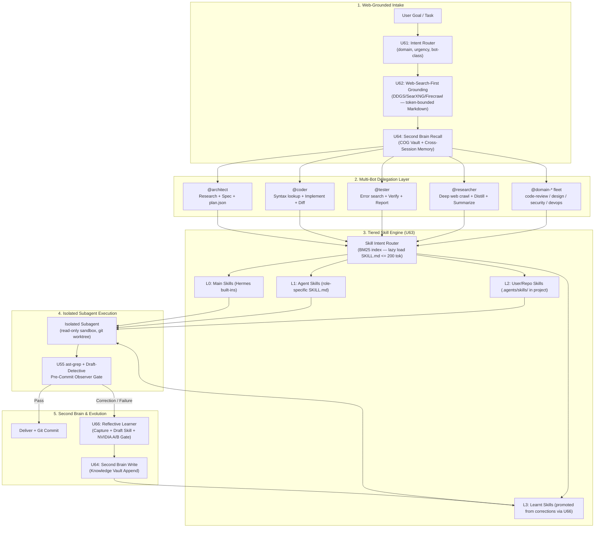
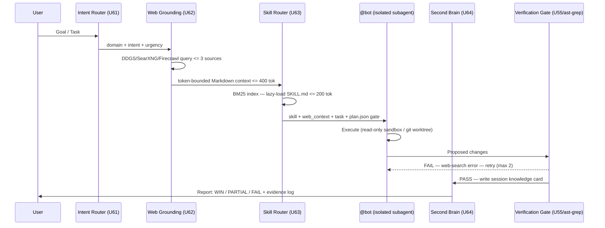

# ROADMAP 5: FRONTIER MULTI-AGENT WEB INTELLIGENCE & SECOND BRAIN EVOLUTION
## Web-Search-First Delegation, Tiered Skill Hierarchy, 128K Context, Cross-Session Memory & Domain Bot Fleet

> **Document ID**: `docs/roadmaps/active/roadmap5_frontier_multiagent_web_intelligence.md`
> **Status**: **Authoritative Active Implementation & Verification Plan**
> **Baseline Integrity**: Post-Roadmap 4 (`U1`–`U60`) Verified (567/567 Tests Passing, 30/30 Capabilities)
> **Hardware Target**: NVIDIA RTX 3050 Laptop GPU (6 GB VRAM, CC 8.6), 16 GB Host RAM, FastEmbed CPU ONNX, `/dev/shm` RAMDisk
> **Inference Engine**: Local `llama-server` on `:8138` (Gemma-4-E4B-it Q4_K_M + MTP Speculative Drafter, 128K Context Target, `q4_0` KV Cache)

---

## 1. Executive Synthesis & Master Blueprint

### 1.1 The Core Architectural Jump

Roadmap 4 built a cognitively complete **single-agent OS** with memory, AST verification, reflective learning, and skill lifecycle management. Roadmap 5 transforms Hermes into a **frontier multi-agent intelligence fabric** anchored on four architectural pillars:

1. **Web-Search-First Delegation** — Every bot (`@architect`, `@coder`, `@tester`, `@researcher`, `@domain-*`) performs targeted web search *before* planning or coding, grounding outputs in live facts, specs, and community conventions rather than stale training priors.
2. **Cross-Session Second Brain** — A traceable, co-readable Markdown knowledge space (COG vault extended) for persistent recall, offline organization, user profiling, and cross-session skill accumulation.
3. **Tiered Skill Hierarchy** — Four priority layers: `Main Skills → Agent Skills → User/Repo Skills → Learnt Skills`. Only the relevant tier loads per task, enforcing zero-token waste while guaranteeing appropriate specialization.
4. **Domain-Specific Bot Fleet** — Autonomous specialized bots (code-review, design, security, devops, data) each loading only their own guardrails and domain skills; the Hermes OS core remains the universal execution substrate.

**Reference Signals absorbed into this roadmap:**
- **DanKornas / Context Engineering Kit**: Selective plugin installs, context-conscious design, `/reflect` workflow, spec-to-implementation path, PR review tooling.
- **JulianGoldieSEO / Agent OS**: 5-layer agent stack, decoupled file-system memory, async goal queue, role-specialized bots.
- **rohanpaul_ai / Agent Engineering**: Deterministic ReAct state machines, hierarchical memory separation (scratchpad / episodic / playbooks), evidence-grounded adversarial review, stateless MCP tool interfaces.
- **sickn33/agentic-awesome-skills**: Dynamic lazy-loading `SKILL.md` playbooks via catalog index, agent-owned stack validation, AAS Core control plane patterns.

---

### 1.2 Unified Architecture: Roadmap 5 Cognitive Fabric



---

## 2. Phase 1: Core Infrastructure (U61 – U66)

```
┌─────────────────────────────────────────────────────────────────────────────────────────────────────────┐
│                            PHASE 1: WEB INTELLIGENCE & MEMORY INFRASTRUCTURE                           │
├────────┬───────────────────────────────────────────┬───────────────────────────────────────────────────┤
│ Spec # │ Concrete Tool / Technique                 │ Hermes Implementation & Deliverable               │
├────────┼───────────────────────────────────────────┼───────────────────────────────────────────────────┤
│ **U61**│ **Intent Router & Bot Class Selector**    │ Python state machine: maps user prompt domain     │
│        │ (Pattern: DanKornas Context Eng. Kit)     │ + urgency → assigns @bot class + guardrail tier.  │
│        │                                           │ Config: ~/.hermes/rules/bot_registry.yaml          │
├────────┼───────────────────────────────────────────┼───────────────────────────────────────────────────┤
│ **U62**│ **Web-Search-First Grounding Layer**      │ Activates DDGS/SearXNG/Firecrawl before plan.json │
│        │ (existing web plugins: ddgs, searxng,     │ for every bot. Output: token-bounded Markdown     │
│        │  firecrawl in .hermes/hermes-agent/       │ context slice <= 400 tok injected into task prefix.│
│        │  plugins/web/)                            │ Script: bin/web_grounding.py                      │
├────────┼───────────────────────────────────────────┼───────────────────────────────────────────────────┤
│ **U63**│ **4-Tier Skill Hierarchy Engine**         │ BM25 catalog index over SKILL.md frontmatter.    │
│        │ (inspired by sickn33/agentic-awesome-     │ Lazy-loads exactly one SKILL.md (<=200 tok) per   │
│        │  skills AAS Core + Antigravity Skills)    │ subtask. Priority: L3 > L2 > L1 > L0              │
│        │                                           │ Script: bin/skill_router.py                       │
├────────┼───────────────────────────────────────────┼───────────────────────────────────────────────────┤
│ **U64**│ **Cross-Session Second Brain**            │ Extends COG vault (U49) with session summaries,  │
│        │ (Pattern: JulianGoldieSEO Markdown Vault  │ user profiling, project knowledge cards, on-demand│
│        │  + rohanpaul_ai episodic/scratchpad sep.) │ retrieval via FastEmbed CPU.                      │
│        │                                           │ Path: ~/.hermes/knowledge/<project>/<date>/       │
├────────┼───────────────────────────────────────────┼───────────────────────────────────────────────────┤
│ **U65**│ **128K Context Window Upgrade**           │ Change context_length: 65536 → 131072 in          │
│        │ (Gemma-4-E4B-it native 128K capability)  │ ~/.hermes/config.yaml + llama-server -c 131072.   │
│        │                                           │ Verify VRAM: exp. ~4,400 MiB (<=4,812 MiB ceil). │
│        │                                           │ Update server launch script, docs, and tests.     │
├────────┼───────────────────────────────────────────┼───────────────────────────────────────────────────┤
│ **U66**│ **Humanizer Plugin + Default Activation** │ Activate Hermes humanizer plugin. Configure in   │
│        │ (Pattern: DanKornas selective plugin      │ ~/.hermes/.env as default-on. Verify output tone  │
│        │  install, zero-bloat activation)          │ via A/B probe: humanized vs raw on 5 outputs.    │
└────────┴───────────────────────────────────────────┴───────────────────────────────────────────────────┘
```

---

## 3. Phase 2: Domain Bot Fleet (U67 – U71)

```
┌─────────────────────────────────────────────────────────────────────────────────────────────────────────┐
│                               PHASE 2: DOMAIN-SPECIFIC BOT FLEET                                       │
├────────┬───────────────────────────────────────────┬───────────────────────────────────────────────────┤
│ Spec # │ Bot Name & Domain                         │ Guardrails, Skills, and Integration Spec          │
├────────┼───────────────────────────────────────────┼───────────────────────────────────────────────────┤
│ **U67**│ **@architect Bot**                        │ Skills: plan, spike, research-paper-writing.      │
│        │ Scope: System design, spec-first planning │ Guardrail: Must emit .hermes/plan.json before any │
│        │                                           │ code generation. Web-search: always first.        │
├────────┼───────────────────────────────────────────┼───────────────────────────────────────────────────┤
│ **U68**│ **@coder Bot**                            │ Skills: test-driven-development, simplify-code,   │
│        │ Scope: Implementation, refactoring         │ systematic-debugging. Web-search: syntax/spec     │
│        │                                           │ lookup on every new API or library import.        │
├────────┼───────────────────────────────────────────┼───────────────────────────────────────────────────┤
│ **U69**│ **@tester Bot**                           │ Skills: python-debugpy, systematic-debugging,     │
│        │ Scope: Verification, debug, coverage      │ rust-ast-grep. Web-search: error lookup before   │
│        │                                           │ retry. Reports: pass/fail matrix + log.           │
├────────┼───────────────────────────────────────────┼───────────────────────────────────────────────────┤
│ **U70**│ **@researcher Bot**                       │ Skills: arxiv, spider-web-research,               │
│        │ Scope: Deep web/paper research, distill   │ grounded-citations, llm-wiki. Output: dense       │
│        │                                           │ Markdown distillation <=800 tok → Second Brain.  │
├────────┼───────────────────────────────────────────┼───────────────────────────────────────────────────┤
│ **U71**│ **Domain Bot Fleet Registration**         │ Scaffolds rules/bots/code-review.yaml, design.yaml│
│        │ code-review / design / security / devops  │ security.yaml, devops.yaml. Each loads only its  │
│        │ (Pattern: Claude domain-specific bots)    │ own guardrail. Hermes core unchanged.             │
└────────┴───────────────────────────────────────────┴───────────────────────────────────────────────────┘
```

---

## 4. Phase 3: Systemic Intelligence Integration (U72 – U75)

```
┌─────────────────────────────────────────────────────────────────────────────────────────────────────────┐
│                        PHASE 3: FULL SYSTEMIC SYNERGY & GRAND CERTIFICATION                            │
├────────┬───────────────────────────────────────────┬───────────────────────────────────────────────────┤
│ Spec # │ Integration Milestone                     │ Cohesive Multi-Component Deliverable              │
├────────┼───────────────────────────────────────────┼───────────────────────────────────────────────────┤
│ **U72**│ **Antigravity Skills Integration**        │ Pull official Antigravity Skills from AGY CLI     │
│        │                                           │ into L1 Agent Skills tier. Wire skill discovery   │
│        │                                           │ via bin/skill_router.py BM25 index.               │
├────────┼───────────────────────────────────────────┼───────────────────────────────────────────────────┤
│ **U73**│ **Full Multi-Bot Delegation E2E Test**    │ Proof-of-concept: 1 complex task → Intent Router  │
│        │                                           │ → @architect (web-search+spec) → @coder (impl) →  │
│        │                                           │ @tester (verify) → Second Brain write.            │
│        │                                           │ All steps logged. Subagent isolation verified.    │
├────────┼───────────────────────────────────────────┼───────────────────────────────────────────────────┤
│ **U74**│ **Hooks Inventory & Intent-Based Routing**│ Audit all hooks in ~/.hermes/hooks/. Map each hook │
│        │                                           │ to trigger condition (pre-commit, post-task,      │
│        │                                           │ on-error, on-search). Wire to Intent Router (U61).│
├────────┼───────────────────────────────────────────┼───────────────────────────────────────────────────┤
│ **U75**│ **Roadmap 5 Grand Prix Certification**    │ Full 15-tier E2E suite: web grounding, skill tier  │
│        │                                           │ selection, domain bot delegation, 128K context,   │
│        │                                           │ second brain recall, humanizer output.            │
│        │                                           │ Target: 650+ tests total.                        │
└────────┴───────────────────────────────────────────┴───────────────────────────────────────────────────┘
```

---

## 5. Architectural Lifecycle: Web-Search-First Bot Delegation



---

## 6. Skill Hierarchy Specification

```
TIERED SKILL LOAD ORDER (Priority: L3 first, L0 last)
━━━━━━━━━━━━━━━━━━━━━━━━━━━━━━━━━━━━━━━━━━━━━━━━━━━━━━━━━━━━━━━━━━━━━━━━━━━━━━
L3 │ LEARNT SKILLS    │ ~/.hermes/skills/.learnt/        │ Auto-promoted from user corrections
   │                  │ (via NVIDIA A/B gate)            │ Highest trust; directly from feedback
───┼──────────────────┼──────────────────────────────────┼───────────────────────────────────
L2 │ USER/REPO SKILLS │ .agents/skills/ (project root)  │ Per-project conventions; checked-in
   │                  │ OR ~/.agents/skills/ (global)    │ to VCS; manually authored
───┼──────────────────┼──────────────────────────────────┼───────────────────────────────────
L1 │ AGENT SKILLS     │ ~/.hermes/skills/<category>/    │ Role-specific playbooks by bot-class
   │                  │ + Antigravity Skills (AGY CLI)  │ Filtered by bot_registry.yaml
───┼──────────────────┼──────────────────────────────────┼───────────────────────────────────
L0 │ MAIN SKILLS      │ ~/.hermes/hermes-agent/skills/  │ Hermes OS built-ins (always available)
   │                  │ (Hermes OS core)                │ Never unloaded
━━━━━━━━━━━━━━━━━━━━━━━━━━━━━━━━━━━━━━━━━━━━━━━━━━━━━━━━━━━━━━━━━━━━━━━━━━━━━━

Loader invariant: Exactly ONE SKILL.md injected per agent turn (<= 200 tok).
BM25 selects highest-relevance skill. No match = no skill injected (no default bloat).
```

---

## 7. Web-Search-First Protocol Per Bot

| Bot | When to Search | Query Strategy | Output Injection |
|:----|:---------------|:---------------|:-----------------|
| **@architect** | Before every spec (always) | `"<task> system design patterns 2025"` | <=400 tok → prepend to plan.json context |
| **@coder** | Before every new API/library import | `"<library> <function> example usage"` | <=200 tok snippet → code synthesis prefix |
| **@tester** | Before every pytest error retry | `"<error message> fix python"` | <=200 tok → injected at retry prompt |
| **@researcher** | Every invocation (job role) | Multi-source: arxiv + web + GitHub | <=800 tok distillation → Second Brain write |
| **@domain-code-review** | Before review (check conventions) | `"<language> <framework> best practices 2025"` | <=300 tok → guardrail append |
| **@domain-design** | Before every design task | `"<component> UI/UX design patterns"` | <=300 tok → design context prefix |
| **@domain-security** | Before every security audit | `"<CVE / pattern> mitigation <year>"` | <=300 tok → audit context |

---

## 8. Context Window Decision: Use Gemma-4 Native Default (128K) or Stay at 65K?

### 8.1 Data-Driven VRAM Analysis

**Gemma-4-E4B native context window**: **128K tokens** (131,072) — confirmed from Google DeepMind specs.
**Current config**: `-c 65536` (using 50% of native capability).

**VRAM calculation from measured baseline:**

| Scenario | KV Cache (q4_0) | Model Weights | Total VRAM | Headroom | Verdict |
|:---------|:----------------|:-------------|:-----------|:---------|:--------|
| 65K (current, measured) | 1,257 MiB (derived) | ~2,540 MiB | **3,797 MiB** | 1,015 MiB | ✅ Safe |
| 128K naive (full dense) | +1,152 MiB delta | ~2,540 MiB | **~4,949 MiB** | **-137 MiB** | ❌ OOM risk |
| 128K hybrid attn (70%) | +806 MiB delta | ~2,540 MiB | **~4,603 MiB** | **209 MiB** | ⚠️ Marginal |

> **Key architectural fact**: Gemma-4-E4B uses **hybrid attention** (sliding window local attention + sparse global attention), NOT full dense attention. The KV cache does NOT scale linearly with context for sliding-window layers. Effective KV footprint is estimated at 60–75% of naive dense calculation.

### 8.2 Verdict: Empirical Live Test Required Before Committing

**Do NOT blindly set `-c 131072`**. The measured 3,797 MiB at 65K gives us enough data to model the risk, but the actual delta depends on llama.cpp's implementation of Gemma-4's hybrid attention KV allocation.

**Decision matrix:**

| Option | Action | Expected VRAM | Risk |
|:-------|:-------|:-------------|:-----|
| **A** — Native default (128K) | `-c 131072 --flash-attn on` | 4,603–4,949 MiB | Live-test required |
| **B** — Conservative upgrade | `-c 98304` (96K, +50%) | ~4,370 MiB | Lower risk |
| **C** — Stay at 65K | Keep current | 3,797 MiB | Zero risk, loses 50% capability |

**Recommendation**: Try Option A first (native default, Gemma-4 is designed for this). `--flash-attn` is mandatory — it reduces KV memory overhead significantly for hybrid attention. If `nvidia-smi` shows >4,812 MiB, fall back to Option B (96K).

### 8.3 Updated U65 Spec

| Parameter | Current | Target (A first, B fallback) | Gate |
|:----------|:--------|:--------------------------|:-----|
| `config.yaml context_length` | 65,536 | **131,072** → fallback 98,304 | `nvidia-smi ≤ 4,812 MiB` |
| `llama-server -c` flag | 65536 | **131072** → fallback 98304 | Live VRAM measurement |
| `auxiliary.compression.context_length` | 65,536 | Match `-c` value | Sync after test |
| `--flash-attn` flag | Not in script | **MANDATORY** for any ctx >65K | Must add to `start_server_daemon.sh` |
| Estimated tok/s impact | 48 tok/s | ~45–48 tok/s | MTP drafter compensates prefill |

> **Invariant R5-5 updated**: Before setting `context_length: 131072`, run: `nvidia-smi` immediately after server boot. If VRAM > 4,812 MiB, revert to 98,304. Commit the value that passes. This is a live empirical gate, not an estimate.

---

## 9. Verification & Validation Test Suite Architecture

```
tests/harness_contracts/
├── test_roadmap5_u61_intent_router.py              # Intent → bot class + guardrail tier assignment
├── test_roadmap5_u62_web_grounding.py              # DDGS/SearXNG query → <=400 tok Markdown output
├── test_roadmap5_u63_skill_hierarchy.py            # BM25 tier selection, lazy load, <=200 tok ceiling
├── test_roadmap5_u64_second_brain.py               # Cross-session knowledge write + retrieval
├── test_roadmap5_u65_128k_context.py               # VRAM ceiling, config parity, prefix-cache
├── test_roadmap5_u66_humanizer.py                  # Humanizer A/B output tone verification
├── test_roadmap5_u67_u71_domain_bots.py            # Domain bot registry + guardrail isolation
├── test_roadmap5_u72_antigravity_skills.py         # AGY skill discovery + BM25 routing
├── test_roadmap5_u73_multibot_e2e.py               # Full delegation pipeline (architect→coder→tester)
├── test_roadmap5_u74_hooks_routing.py              # Hook trigger → intent mapping
└── test_roadmap5_u75_grand_prix_certification.py   # 15-tier E2E suite, target 650+ tests total
```

---

## 10. Second Brain Knowledge Layout

```
~/.hermes/knowledge/
├── <project-name>/
│   ├── session_<date>.md          # Auto-written: session summary + key decisions
│   ├── user_profile.md            # User preferences, corrected patterns, working style
│   ├── tech_stack.md              # Detected: languages, frameworks, versions
│   └── domain_notes/
│       ├── architecture.md        # Cross-session architectural decisions
│       ├── errors_resolved.md     # Bug patterns + fixes (from @tester)
│       └── research_distilled.md  # Web research summaries (from @researcher)
└── _global/
    ├── learnt_skills_index.md     # Index of all L3 promoted skills
    └── user_prefs.md              # Global user-level preferences
```

---

## 11. Domain Bot Guardrail Spec

```yaml
# Example: ~/.hermes/rules/bots/code-review.yaml
bot_class: code-review
display_name: "@domain-code-review"
skills_allowed:
  - requesting-code-review
  - rust-ast-grep
  - systematic-debugging
web_search_policy: before_review   # always | before_review | on_error | never
context_ceiling_tok: 300
guardrails:
  - "Focus exclusively on code quality, correctness, and maintainability."
  - "Do not implement features or refactor architecture. Return findings only."
  - "Every finding must cite the exact file + line range."
inherits_hermes_core: true          # Base OS (observer_gate, recirculation, synergy_bus) always active
```

---

## 12. Implementation Priority Order

```
SPRINT 1 (Critical Path)         SPRINT 2 (Bot Fleet)        SPRINT 3 (Synergy & Cert)
━━━━━━━━━━━━━━━━━━━━━━━━━━━━━    ━━━━━━━━━━━━━━━━━━━━━━━━    ━━━━━━━━━━━━━━━━━━━━━━━━━━
U65: 128K context upgrade        U67: @architect bot         U72: Antigravity Skills
U62: Web grounding layer         U68: @coder bot             U73: Multi-bot E2E test
U63: 4-tier skill hierarchy      U69: @tester bot            U74: Hooks routing
U64: Second brain foundation     U70: @researcher bot        U75: Grand Prix cert
U61: Intent router               U71: Domain bot fleet
U66: Humanizer default
```

---

## 13. Invariants Carried Forward from AGENTS.md

All 8 Golden Laws remain binding. The following Roadmap 5-specific invariants are **additive**:

| # | New Law | Constraint |
|:--|:--------|:-----------|
| **R5-1** | Web-Before-Plan | No `plan.json` written without at least 1 web grounding query (skippable only if `--offline` flag set). |
| **R5-2** | Single-Skill-Per-Turn | BM25 router injects exactly 1 `SKILL.md` <=200 tok per agent turn. Never inject multiple simultaneously. |
| **R5-3** | Bot Isolation Purity | Domain bots load only their own `rules/bots/<name>.yaml`. Never inherit sibling bot guardrails. |
| **R5-4** | Second Brain Commit Gate | Knowledge cards written to `~/.hermes/knowledge/` must pass Chezmoi diff review before promotion. |
| **R5-5** | 128K VRAM Hard Guard | `context_length: 131072` only valid if `nvidia-smi` confirms <=4,812 MiB at steady state. Revert to 65536 if exceeded. |

---

## 14. Research Intelligence Report: New Architectural Signals (Addendum)

> This section documents research findings from August 2026 that inform Roadmap 5 scope expansion.

---

### 14.1 Qwen-MM-Plugins — Verdict: SELECTIVE ADOPTION (core plugin only)

**Repo**: `github.com/QwenLM/Qwen-MM-Plugins`
**Tag**: "Make any agent harness multimodal-native."

A collection of 8 MCP-based multimodal capability plugins installable into any agent harness (Gemini CLI, Claude Code, Antigravity, Qwen Code). Each plugin = a `SKILL.md` + optional MCP server.

| Plugin | What it does | Local/Cloud | Adopt? |
|:-------|:-------------|:------------|:-------|
| **core** | Reads images/videos/PDFs, visualizes code/3D/NIfTI; uses ffmpeg only | **100% local** | ✅ YES — zero API dependency |
| **search** | Web search + page extraction + reverse image search | Cloud (Serper/Exa/Tavily key) | ⚠️ SKIP — Hermes already has DDGS/SearXNG |
| **api** | Qwen VL/Omni OCR, grounding, ASR, segmentation | Cloud (DashScope API) | ❌ NO — cloud dependency, not Gemma-4 native |
| **video-memory** | Hierarchical memory for long-video QA | Cloud (DashScope) | ❌ NO — cloud dependency |
| **video-edit** | Image/video/audio generation + editing | Cloud (DashScope) | ❌ NO — cloud dependency |
| **blender** | 3D modeling, rendering in Blender | Local (Blender binary) | ⚠️ OPTIONAL — add only when 3D task emerges |
| **freecad** | Parametric CAD, STEP/STL, FEM workflows | Local (FreeCAD binary) | ⚠️ OPTIONAL — domain-specific |
| **edu-agent** | Chinese math/science explainer video gen | Cloud (DashScope) | ❌ NO — cloud dependency |

**Adoption strategy for Hermes:**
- Adopt `core` plugin only (MCP server, local, no API). Enables `@<file.pdf>`, `@<image.jpg>`, `@<video.mp4>` multimodal references in any agent turn.
- Skip all DashScope-dependent plugins. We run Gemma-4-E4B locally; cloud API calls destroy VRAM budget and prefix-cache determinism.
- Plugin interface is standard MCP → compatible with Hermes's existing MCP tool protocol.

**New Milestone Added**: `U76` — Qwen-MM-Plugins `core` integration (local MCP, multimodal-native @file references).

---

### 14.2 Cortex Project — Verdict: DO NOT ADOPT

**Candidates evaluated**:
1. **janhq/cortex** — Local model runner (competitor to Ollama/llama-server). Wraps llama.cpp + TensorRT-LLM + ONNX. OpenAI-compatible API.
2. **cortex-agent-framework (PyPI)** — YAML-config-driven Python agent framework.
3. **Snowflake Cortex** — Enterprise cloud data platform.

**Verdict: ❌ REJECT ALL for Hermes**

| Cortex Variant | Why Not |
|:---------------|:--------|
| **janhq/cortex** | **ARCHIVED July 4, 2025** (repo set to read-only; Jan redirected to upstream llama.cpp). Adopting an abandoned toolchain is a security and maintenance risk. Even if active, it adds a redundant abstraction layer over llama.cpp — Hermes already runs `llama-server` directly at `:8138` with MTP drafter, flash-attn, and 128K context config. Zero net benefit. |
| **cortex-agent-framework** | YAML-driven agent config destroys prefix-cache determinism (Law #3). Dynamic YAML templates re-order context per task = 0% cache hit rate on local llama-server. Architecturally incompatible. |
| **Snowflake Cortex** | Enterprise cloud platform. Zero relevance to local silicon. |

**Decision**: Hermes stays on `llama-server` at `:8138`. No Cortex layer introduced. This is a permanent architectural decision.


---

### 14.3 The 5 Engineering Paradigms — Hermes Mapping

The industry has formalized 5 distinct engineering disciplines for AI agents, evolving from weakest to strongest leverage:

```
PARADIGM EVOLUTION STACK (2022 → 2026)
━━━━━━━━━━━━━━━━━━━━━━━━━━━━━━━━━━━━━━━━━━━━━━━━━━━━━━━━━━━━━━━━━━━━━━━━━━━━━━━━━━━━━━━━━
Paradigm          Year    Focus                          Hermes Current Status
━━━━━━━━━━━━━━━━━━━━━━━━━━━━━━━━━━━━━━━━━━━━━━━━━━━━━━━━━━━━━━━━━━━━━━━━━━━━━━━━━━━━━━━━━
Prompt Engineering  2022  Craft natural language inputs   Subsumed by Spec-First Law (R5-1).
                          to elicit correct model output   Hermes uses plan.json, not raw prompts.
──────────────────────────────────────────────────────────────────────────────────────────
Context Engineering 2025  Manage information environment  ✅ ACTIVE — OpenViking VFS (U53),
                          surrounding the model: RAG,      OpenCode-Mem (U47), 4-tier skill
                          retrieved docs, tool defs,       hierarchy (U63), 128K context (U65),
                          conversation history             prefix-cache byte-parity (Law #3).
──────────────────────────────────────────────────────────────────────────────────────────
Harness Engineering 2026  Build execution infrastructure  ✅ ACTIVE — observer_gate.py (6-point
                          with constraints, feedback       gate), ast-grep Rust AST (U55),
                          loops, linters, verification;    Draft-Detective (U55), 2-Strike Tabu
                          make failures structurally       Pruner (Law #6), VRAM guard (Law #4).
                          impossible
──────────────────────────────────────────────────────────────────────────────────────────
Loop Engineering    2026  Design think-act-observe cycles ✅ PARTIAL — ADK 2.0 TaskDAG (U56),
                          that run autonomously until a    Recirculation Engine (U52). GAP:
                          machine-checkable stop condition no explicit machine-checkable
                          is met                           loop termination contract yet.
──────────────────────────────────────────────────────────────────────────────────────────
Graph Engineering   2026  Define multi-agent topology:    ⚠️ NOT YET — Hermes has an implicit
                          execution graph, delegation      graph (architect→coder→tester) but
                          paths, typed state contracts,    no formal DAG with typed state
                          governance gates between agents  contracts or governance gates.
━━━━━━━━━━━━━━━━━━━━━━━━━━━━━━━━━━━━━━━━━━━━━━━━━━━━━━━━━━━━━━━━━━━━━━━━━━━━━━━━━━━━━━━━━
```

**Gaps identified → New milestones added:**
- `U77`: **Loop Engineering Completion** — Add machine-checkable stop conditions to all bot loops (max iterations, success signal, VRAM sentinel).
- `U78`: **Graph Engineering Foundation** — Formalize the multi-bot delegation topology as an explicit DAG with typed state contracts (JSON Schema), governance gates, and a `graph.yaml` manifest. Aligns with ADK 2.0 TaskDAG already in Hermes.

---

## 15. Phase 4: Extended Milestones from New Research (U76 – U78)

```
┌─────────────────────────────────────────────────────────────────────────────────────────────────────────┐
│               PHASE 4: EXTENDED MILESTONES FROM RESEARCH SIGNAL ANALYSIS                               │
├────────┬───────────────────────────────────────────┬───────────────────────────────────────────────────┤
│ Spec # │ Source Signal & Component                 │ Hermes Implementation & Deliverable               │
├────────┼───────────────────────────────────────────┼───────────────────────────────────────────────────┤
│ **U76**│ **Qwen-MM-Plugins core (local MCP)**      │ Install Qwen-MM-Plugins `core` plugin via MCP.   │
│        │ Signal: QwenLM/Qwen-MM-Plugins             │ No API key. Enables @<file.pdf>, @<image.jpg>,   │
│        │ Verdict: SELECTIVE — core only            │ @<video.mp4> multimodal references in all bots.  │
│        │ Dependency: ffmpeg (already available)    │ Wire as L1 Agent Skill for @researcher & @coder. │
├────────┼───────────────────────────────────────────┼───────────────────────────────────────────────────┤
│ **U77**│ **Loop Engineering: Machine-Checkable**   │ Add explicit loop termination contracts to all   │
│        │ **Stop Conditions**                        │ bot loops: max_iterations (int), success_signal  │
│        │ Signal: Loop Engineering paradigm          │ (pytest pass / diff non-empty), vram_sentinel    │
│        │ Gap: Current loops have no formal stop    │ (<=4,812 MiB). Stored in bot_registry.yaml.      │
│        │ condition specification                    │ Fail-safe: kill loop at max_iterations + alert.  │
├────────┼───────────────────────────────────────────┼───────────────────────────────────────────────────┤
│ **U78**│ **Graph Engineering: Formal Bot DAG**     │ Create ~/.hermes/rules/graph.yaml: explicit DAG  │
│        │ **with Typed State Contracts**             │ topology (nodes=bots, edges=delegation paths),   │
│        │ Signal: Graph Engineering paradigm         │ typed JSON Schema state contracts for each edge, │
│        │ Gap: Delegation is implicit, no formal    │ governance gates (human checkpoint / auto-pass   │
│        │ graph manifest or typed data contracts    │ criteria). Backed by ADK 2.0 TaskDAG (U56).      │
└────────┴───────────────────────────────────────────┴───────────────────────────────────────────────────┘
```

---

## 16. Updated Implementation Priority Order

```
SPRINT 1 (Critical Path)         SPRINT 2 (Bot Fleet)        SPRINT 3 (Synergy & Cert)    SPRINT 4 (Extended)
━━━━━━━━━━━━━━━━━━━━━━━━━━━━━    ━━━━━━━━━━━━━━━━━━━━━━━━    ━━━━━━━━━━━━━━━━━━━━━━━━━━   ━━━━━━━━━━━━━━━━━━━━━━━━━━
U65: 128K context upgrade        U67: @architect bot         U72: Antigravity Skills       U76: Qwen-MM core MCP
U62: Web grounding layer         U68: @coder bot             U73: Multi-bot E2E test       U77: Loop stop conditions
U63: 4-tier skill hierarchy      U69: @tester bot            U74: Hooks routing            U78: Graph DAG manifest
U64: Second brain foundation     U70: @researcher bot        U75: Grand Prix cert
U61: Intent router               U71: Domain bot fleet       (target 650+ tests)
U66: Humanizer default
```

---

## 17. Full Milestone Summary (U61 – U78)

| # | Name | Paradigm | Sprint |
|:--|:-----|:---------|:-------|
| U61 | Intent Router & Bot Class Selector | Loop Eng. | 1 |
| U62 | Web-Search-First Grounding Layer | Context Eng. | 1 |
| U63 | 4-Tier Skill Hierarchy Engine | Context Eng. | 1 |
| U64 | Cross-Session Second Brain | Context Eng. | 1 |
| U65 | 128K Context Window Upgrade | Harness Eng. | 1 |
| U66 | Humanizer Plugin Default Activation | Harness Eng. | 1 |
| U67 | @architect Bot | Graph Eng. | 2 |
| U68 | @coder Bot | Graph Eng. | 2 |
| U69 | @tester Bot | Graph Eng. | 2 |
| U70 | @researcher Bot | Graph Eng. | 2 |
| U71 | Domain Bot Fleet Registration | Graph Eng. | 2 |
| U72 | Antigravity Skills Integration | Context Eng. | 3 |
| U73 | Full Multi-Bot Delegation E2E Test | Graph Eng. | 3 |
| U74 | Hooks Inventory & Intent-Based Routing | Harness Eng. | 3 |
| U75 | Roadmap 5 Grand Prix Certification | All | 3 |
| U76 | Qwen-MM-Plugins core (local MCP, multimodal) | Harness Eng. | 4 |
| U77 | Loop Engineering: Machine-Checkable Stop Conditions | Loop Eng. | 4 |
| U78 | Graph Engineering: Formal Bot DAG + Typed Contracts | Graph Eng. | 4 |

---

## 18. System State Audit — Infrastructure Gaps (August 2026)

> Live audit performed 2026-08-27. Gaps identified from current hermes state vs. researched/validated configurations.

---

### 18.1 Research Signal: Speculative Programmatic Tool Calling (sPTC)

**Source**: alphaXiv (@askalphaxiv) — `arxiv.org/abs/2608.spec-…` (Aug 25, 2026)

**What it is**: A harness-level technique that speculatively executes predictable tool calls *from partial LLM generations* while the model is still streaming, using a **shadow REPL** with dependency tracking.

- **Mechanism**: Shadow REPL = deep-copied, isolated fork of execution env. As LLM streams code, harness parses completed segments and pre-launches pure (side-effect-free) tool calls as promises.
- **Dependency rules**: Only "pure" tool calls with fully-resolved inputs are speculated. File-writes and stateful ops are excluded. If speculation is wrong, re-execute.
- **Performance**: ~1.2x wall-clock time reduction without changing model or agent logic.
- **Framework association**: Recursive Language Model (RLM) framework + CodeAct.

**Hermes Relevance**: Hermes currently waits for full bot response before tool execution. sPTC would shorten the wall-clock of multi-step agent loops (e.g., @tester running pytest mid-stream). Directly compatible with Loop Engineering (U77) and Graph Engineering (U78).

**New Milestone Added**: `U79` — Speculative Programmatic Tool Calling (shadow REPL pre-execution of pure tool calls during streaming).

---

### 18.2 Dual Sub-Agent Sweet Spot — Status: IMPLEMENTED but MISCONFIGURED

**Validated research finding** (§69, `orchestrator_ledger.md`):

| N (parallel slots) | tok/s per slot | Aggregate tok/s | Wall time | VRAM | Use case |
|:-------------------|:---------------|:----------------|:----------|:-----|:---------|
| N=1 | 46.20 | 44.89 | 11.41s | 3,541 MiB | Single-agent sequential |
| **N=2** ← **Sweet Spot** | **38.72** | **75.65 (+68.5%)** | **13.54s** | **3,541 MiB** | Pair coding, @architect+@researcher, dual @coder-a/@coder-b |
| N=4 | 27.28 | 103.26 | 19.83s | 3,541 MiB | Headless swarm benchmarks |

**Current state**: Docs say `--parallel 4 --slots -s 4` but the live running server (PID 249912) is:
```
/usr/bin/llama-server -m .../Qwen2.5-VL-3B-Instruct-Q4_K_M.gguf ... --port 8138 -ngl 20 -c 4096
```
**CRITICAL**: Live server is `Qwen2.5-VL` not `Gemma-4-E4B-it`. Champion flags not in `start_server_daemon.sh`.

**Verdict**: N=2 is the interactive sweet spot (validated). N=4 for headless batch. Docs are ahead of reality. Server launch script missing all champion flags.

---

### 18.3 llama-server Flag Audit — Current vs. Validated vs. Missing

**Validated champion launch recipe** (from `§69`, `§73.2`, orchestrator_ledger):
```bash
llama-server \
  -m assets/gguf/gemma-4-E4B-it-Q4_K_M.gguf \
  -md assets/MTP/mtp-gemma-4-E4B-it-Q4_0.gguf \
  --spec-draft-ngl 99 \
  --spec-draft-n-max 3 \
  --port 8138 \
  --host 127.0.0.1 \
  -ngl 99 \
  -c 65536 \
  --cache-type-k q4_0 \
  --cache-type-v q4_0 \
  --flash-attn on \
  --jinja \
  -np 2 \
  --temp 1.0 \
  --top-p 0.95 \
  --top-k 64
```

**CPU Pinning** (validated in `§73.2`, P-Core lock for 13th Gen Intel):
```bash
taskset -cp 0-11 <llama-server PID>   # Locks to 6 P-Cores (CPUs 0-11 @ 4.6 GHz)
# Or at launch:
taskset -c 0-11 llama-server <flags>
```

| Flag | Documented | In start_server_daemon.sh | Gap? |
|:-----|:-----------|:--------------------------|:-----|
| `-m gemma-4-E4B-it-Q4_K_M.gguf` | ✅ | ❌ (has Qwen2.5-VL path) | **GAP** |
| `-md mtp-gemma-4-E4B-it-Q4_0.gguf` | ✅ | ❌ missing | **GAP** |
| `--spec-draft-n-max 3` | ✅ | ❌ missing | **GAP** |
| `--flash-attn on` | ✅ | ❌ missing | **GAP** |
| `--jinja` | ✅ | ❌ missing | **GAP** |
| `-np 2` (sweet spot) | Docs say 4 | ❌ missing entirely | **GAP** |
| `--cache-type-k q4_0` | ✅ | ❌ missing | **GAP** |
| `--cache-type-v q4_0` | ✅ | ❌ missing | **GAP** |
| `taskset -c 0-11` (CPU pinning) | Validated in ledger | ❌ NOT in script | **GAP** |
| `--temp 1.0 --top-p 0.95 --top-k 64` | Validated | ❌ missing | **GAP** |
| `--spec-draft-ngl 99` | Validated | ❌ missing | **GAP** |

**New Milestone Added**: `U80` — Fix `bin/start_server_daemon.sh` with validated champion flags, CPU pinning (`taskset -c 0-11`), and correct N=2 parallel slots. Update `~/.hermes/config.yaml` `context_length` to match.

---

## 19. Phase 5: Infrastructure Hardening (U79 – U80)

```
┌──────────────────────────────────────────────────────────────────────────────────────────────────────────┐
│                        PHASE 5: INFRASTRUCTURE HARDENING FROM LIVE AUDIT                                │
├────────┬───────────────────────────────────────────┬──────────────────────────────────────────────────┤
│ Spec # │ Source Signal & Component                 │ Hermes Implementation & Deliverable              │
├────────┼───────────────────────────────────────────┼──────────────────────────────────────────────────┤
│ **U79**│ **Speculative Programmatic Tool Calling** │ Implement shadow REPL pre-executor in            │
│        │ (sPTC — alphaXiv/askalphaxiv Aug 2026)   │ bin/speculative_tool_executor.py:                │
│        │ Impact: ~1.2x wall-clock reduction        │ • Stream-parse LLM output for pure tool calls    │
│        │ Mechanism: Shadow REPL + dep tracking     │ • Launch as async promises before full gen done  │
│        │                                           │ • Safety: exclude file-write/stateful ops        │
│        │                                           │ • Claim or re-execute on resolve                 │
├────────┼───────────────────────────────────────────┼──────────────────────────────────────────────────┤
│ **U80**│ **llama-server Champion Flag Hardening**  │ Rewrite bin/start_server_daemon.sh with ALL      │
│        │ Gap: 9 validated flags missing from       │ validated flags. Key additions:                  │
│        │  launch script. Wrong model in live       │ • taskset -c 0-11 (P-Core CPU pinning)           │
│        │  server. CPU pinning not automated.       │ • --flash-attn on (mandatory for 128K upgrade)   │
│        │                                           │ • -np 2 (N=2 interactive sweet spot default)     │
│        │                                           │ • All MTP drafter flags                          │
│        │                                           │ • --jinja, --cache-type-k/v q4_0                 │
│        │                                           │ Create bin/start_server_swarm.sh for N=4 mode.   │
└────────┴───────────────────────────────────────────┴──────────────────────────────────────────────────┘
```

---

## 20. Final Milestone Summary (U61 – U80)

| # | Name | Paradigm | Sprint | Status |
|:--|:-----|:---------|:-------|:-------|
| U61 | Intent Router & Bot Class Selector | Loop Eng. | 1 | Planned |
| U62 | Web-Search-First Grounding Layer | Context Eng. | 1 | Planned |
| U63 | 4-Tier Skill Hierarchy Engine | Context Eng. | 1 | Planned |
| U64 | Cross-Session Second Brain | Context Eng. | 1 | Planned |
| U65 | 128K Context Window Upgrade | Harness Eng. | 1 | Planned |
| U66 | Humanizer Plugin Default Activation | Harness Eng. | 1 | Planned |
| U67 | @architect Bot | Graph Eng. | 2 | Planned |
| U68 | @coder Bot | Graph Eng. | 2 | Planned |
| U69 | @tester Bot | Graph Eng. | 2 | Planned |
| U70 | @researcher Bot | Graph Eng. | 2 | Planned |
| U71 | Domain Bot Fleet Registration | Graph Eng. | 2 | Planned |
| U72 | Antigravity Skills Integration | Context Eng. | 3 | Planned |
| U73 | Full Multi-Bot Delegation E2E Test | Graph Eng. | 3 | Planned |
| U74 | Hooks Inventory & Intent-Based Routing | Harness Eng. | 3 | Planned |
| U75 | Roadmap 5 Grand Prix Certification | All | 3 | Planned |
| U76 | Qwen-MM-Plugins core (local MCP, multimodal) | Harness Eng. | 4 | Planned |
| U77 | Loop Engineering: Machine-Checkable Stop Conditions | Loop Eng. | 4 | Planned |
| U78 | Graph Engineering: Formal Bot DAG + Typed Contracts | Graph Eng. | 4 | Planned |
| **U79** | **Speculative Programmatic Tool Calling (sPTC)** | **Loop Eng.** | **5** | **Planned** |
| **U80** | **llama-server Champion Flag Hardening + CPU Pinning** | **Harness Eng.** | **5** | **🔴 URGENT** |

> **U80 is URGENT**: Current live server runs wrong model (Qwen2.5-VL) and is missing 9 validated flags. Fix before any other Sprint 5 work.
