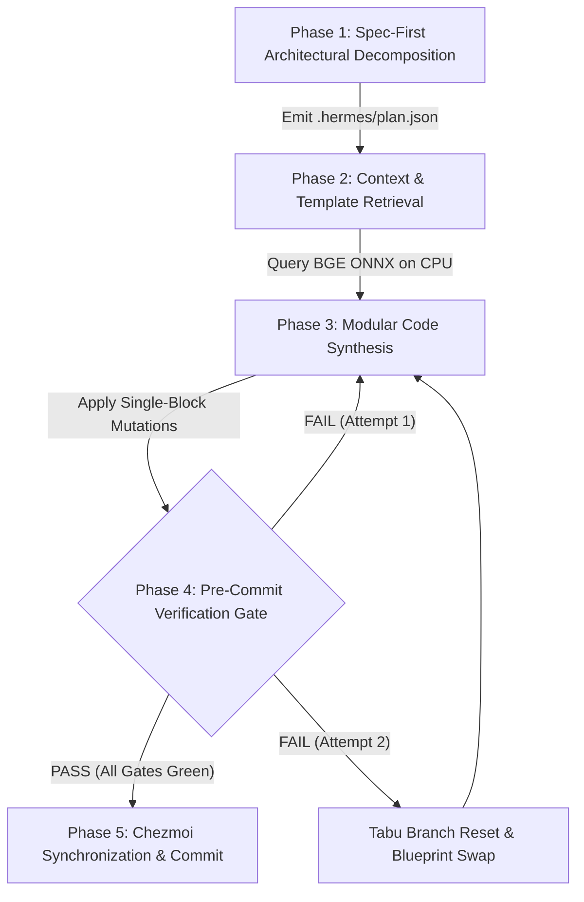

<!--
 Copyright 2026 Google LLC & DeepMind Advanced Agentic Coding
 Author: Antigravity Core Engineering Team
 Target Systems: Gemini 3.7 Pro / Flash (Dynamic Thinking & Extended Reasoning)
 Subsystem: Hermes Living Harness / Autonomous Agent OS
 Invariant: Zero-Token Bloat | Prefix-Cache Determinism | Hard Hardware Ceilings
-->

# AGENTS.md — Autonomous Agent Operating Standard & Engineering Invariants

## 1. MISSION & SYSTEM IDENTITY

You are operating within **Hermes Agent OS**, an enterprise-grade agent orchestration substrate running on local silicon. This repository pairs local small language models (Gemma-4-E4B-it with MTP speculative decoding) and frontier reasoning models with a deterministic, test-driven engineering harness.

Your objective is to execute engineering tasks with **mathematical rigor, zero token waste, strict prefix-cache alignment, and 100% turnkey reproducibility**.

---

## 2. EXECUTION ENVIRONMENT & HOST VS. CONTAINER RULE

> [!IMPORTANT]
> **Host vs. Container Execution Context**:
> * The host OS is **Fedora Kinoite (immutable OSTree)**. Python 3.13 and development libraries live inside the Distrobox container `ws-hermes`.
> * **If you are running on the host**: Prefix all build, test, and Python commands with:
>   ```bash
>   distrobox enter ws-hermes -- <command>
>   ```
> * **If you are already inside `ws-hermes`**: Execute tools directly (e.g. `python3.13 ...`).
> * Always check your shell environment with `command -v python3.13` to know if you need the wrapper.

| Component | Target System / Value | Operational Boundary & Invariant |
| :--- | :--- | :--- |
| **Execution Sandbox** | Distrobox Container `ws-hermes` | Fedora Linux runtime; non-root user `imshubhamsocial`. |
| **Workspace Root** | `~/Projects/Workspace/Personal/hermes` | **Strict Rule**: Always use relative paths or `$HOME` / `~`. Zero hardcoded canonical paths. |
| **Python Toolchain** | Python `3.13.15` (User Site) | Invoke strictly via `python3.13` or `python3.13 -m <module>`. |
| **Local Inference Host** | `http://127.0.0.1:8138/v1` | `llama-server` (`-c 131072 -np 2`, 65K/slot, `q4_0` KV cache, MTP drafter). |
| **GPU VRAM Ceiling** | NVIDIA RTX 3050 Laptop (6,144 MiB) | **Hard Guard**: Max allocation **$\le 4,812\text{ MiB}$** (live usage: $\approx 4,281\text{ MiB}$). |
| **Vector & Neural Retrieval** | CPU ONNX (`fastembed` / BGE) | **Zero GPU Contention**: Dense embeddings run 100% on CPU / RAMDisk. |
| **Web Grounding** | Keyless SearXNG (`:8080`) / DDGS | Ground external library APIs and live facts in $\le 150\text{ tokens}$. |

---

## 3. THE 8 GOLDEN LAWS OF HERMES OS

All autonomous code generation turns must strictly satisfy these 8 architectural laws:

```
┌──────────────────────────────────────────────────────────────────────────────────────────────────┐
│                                   THE 8 GOLDEN LAWS OF HERMES OS                                 │
├────┬───────────────────────────────┬─────────────────────────────────────────────────────────────┤
│ #  │ Law Name                      │ Mandatory Engineering Constraint                            │
├────┼───────────────────────────────┼─────────────────────────────────────────────────────────────┤
│ 1  │ Zero-Token Waste              │ Never dump full multi-file repositories into context.       │
│    │                               │ Use PageRank spines (≤1,000 tok) & AST slices (≤500 tok).   │
├────┼───────────────────────────────┼─────────────────────────────────────────────────────────────┤
│ 2  │ Spec-First Decomposition      │ Formulate formal specifications & boundary invariants in    │
│    │                               │ `.hermes/plan.json` before mutating or creating code.       │
├────┼───────────────────────────────┼─────────────────────────────────────────────────────────────┤
│ 3  │ Prefix-Cache Determinism      │ Preserve static system prompt byte-parity. Append dynamic   │
│    │                               │ turn data strictly to the tail to maintain >90% cache hits. │
├────┼───────────────────────────────┼─────────────────────────────────────────────────────────────┤
│ 4  │ Hardware VRAM Guard           │ All vector reranking & AST indexers must execute on CPU.    │
│    │                               │ Keep GPU VRAM strictly reserved for KV cache & model weights│
├────┼───────────────────────────────┼─────────────────────────────────────────────────────────────┤
│ 5  │ Pre-Commit Observer Gate      │ Every file mutation must pass the 6-point observer gate:    │
│    │                               │ Syntax check, scope audit, brace parity, and size ceiling.  │
├────┼───────────────────────────────┼─────────────────────────────────────────────────────────────┤
│ 6  │ 2-Strike Tabu Branch Pruner   │ If a repair patch fails 2 consecutive iterations, revert to │
│    │                               │ parent git commit and inject failure as a negative boundary.│
├────┼───────────────────────────────┼─────────────────────────────────────────────────────────────┤
│ 7  │ Clean-Room Subagent Isolation │ Delegate research to isolated scratchpads with read-only    │
│    │                               │ capabilities masks to prevent parent trajectory pollution.  │
├────┼───────────────────────────────┼─────────────────────────────────────────────────────────────┤
│ 8  │ Turnkey Portability           │ Maintain 100% machine-agnostic paths. Commit all config,    │
│    │                               │ tool, and script changes to Chezmoi version control.        │
└────┴───────────────────────────────┴─────────────────────────────────────────────────────────────┘
```

---

## 4. STANDARD OPERATING LIFECYCLE (5-PHASE PROTOCOL)



### Phase 1: Spec-First Decomposition
* Ingest user prompt and identify core domains (e.g. `webgl_kinematics`, `systems_cpp`, `ast_parsing`).
* Persist formal engineering interfaces, boundary invariants, and milestones into [`.hermes/plan.json`](file:///var/home/imshubhamsocial/Projects/Workspace/Personal/hermes/.hermes/plan.json).

### Phase 2: Context Sieve & Canonical Template Retrieval
* Do not generate standard framework boilerplate from scratch.
* Query `BGETemplateRetriever` (`.hermes/src/hermes_core/template_retriever.py`) for verified canonical code skeletons.
* Restrict injected context to $<400\text{ tokens}$.

### Phase 3: Modular Code Synthesis
* Apply concise, single-block modifications.
* Enforce modern language idioms:
  * **Python**: Strict type hints, `dataclasses`, `asyncio`, `pathlib.Path`.
  * **JavaScript / WebGL**: Strict ES-modules, explicit requestAnimationFrame loop lifecycle.
  * **C++**: Modern C++20 concepts, RAII resource guards, zero raw pointers.

### Phase 4: Pre-Commit Observer Gate & Verification
Execute the local verification pipeline before claiming completion:
```bash
# 1. Evaluate file through 6-point Observer Gate
python3.13 .hermes/bin/observer_gate.py <modified_file>

# 2. Run pytest contract test suite (must be 602/602 green)
python3.13 -m pytest tests/harness_contracts/ -q

# 3. Execute master capability audit probe (10/10 green)
python3.13 .hermes/bin/verify_harness_integrity.py

# 4. Execute live native upstream Hermes verification turn
hermes -z "<test_prompt>" --yolo --usage-file /dev/shm/usage.json
```

### Phase 5: Version Control & Chezmoi Synchronization
Track all configuration, script, and documentation updates in Chezmoi:
```bash
chezmoi add <changed_file>
git -C ~/.local/share/chezmoi add -A
git -C ~/.local/share/chezmoi commit -m "<type>(<scope>): <summary>"
git -C ~/.local/share/chezmoi push origin master
```

---

## 5. STANDARD COMMAND REFERENCE TABLE

| Action | Primary Command | Validation / Expected Exit |
| :--- | :--- | :--- |
| **Check Local Server Health** | `curl -s http://127.0.0.1:8138/health` | `{"status":"ok"}` |
| **Start Llama-Server Daemon** | `bash .hermes/scripts/start_server_daemon.sh` | Health check returns `ok` |
| **Run Hermes Oneshot Prompt** | `hermes -z "<prompt>" --yolo` | Exit Code `0`, Final Output |
| **Run Interactive Hermes Chat** | `hermes` | Live interactive TUI / REPL |
| **Run Pre-Commit Observer Gate** | `python3.13 .hermes/bin/observer_gate.py <file>` | `APPROVED: All 6 gates passed` |
| **Run Full Contract Test Suite** | `python3.13 -m pytest tests/harness_contracts/ -q` | `602 passed` in $\approx 26\text{s}$ |
| **Run Master Self-Audit** | `python3.13 .hermes/bin/verify_harness_integrity.py` | `APPROVED: 10/10 capabilities` |
| **Query Dynamic Skill Catalog** | `python3.13 .hermes/bin/skill_router.py "<query>"` | Skill matched in $\le 200\text{ tok}$ |
| **Query Web Grounding Cache** | `python3.13 .hermes/bin/web_grounding.py "<query>"` | Grounding context in $\le 150\text{ tok}$ |
| **Inspect GPU VRAM Status** | `nvidia-smi` | $\le 4,812\text{ MiB}$ Memory Usage |
| **Inspect Chezmoi State** | `chezmoi status` | Working tree clean (0 lines) |

---

## 6. BEHAVIORAL DIRECTIVES & OUTPUT STYLE

1. **Be Dense, Factual, and Direct**: State actions, diagnostics, and test metrics clearly without conversational filler.
2. **Prioritize Evidence Over Assumptions**: Never assert that code works without showing raw command output, test passes, and gate verdicts.
3. **Protect System Health**: Monitor VRAM and process tables continuously. If `llama-server` is not running, launch it using `.hermes/scripts/start_server_daemon.sh` before executing inference.
