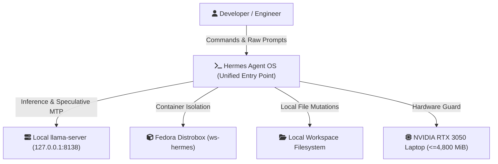
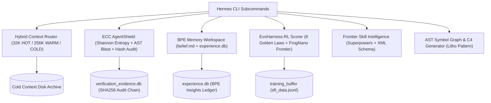

# Hermes Agent OS — C4 Architecture Specification

> **Generated**: 2026-09-11T11:07:39.275312+00:00  
> **Source Engine**: Litho AST Structural Analyzer (`symbol_index`)  
> **Codebase Scope**: 44 Python modules | 59 Classes | 421 Functions  

---

## Level 1: System Context Diagram

---

## Level 2: Container Diagram (Hermes Agent OS Core)

---

## Level 3: Core Subsystems & Invariants

### 1. AgentShield Security Boundary
- **Shannon Entropy Scanner**: Detects credentials and tokens with $H > 4.6$.
- **Role Security Enforcer**: Strict Maker-Verifier isolation (`@architect` read-only, `@coder` mutations, `@tester` test-execution).
- **Cryptographic Audit Trail**: Merkle-style SHA256 chain recording every mutation.

### 2. Hybrid Context & Harness Engineering
- **Context Preservation**: Retains System-2 reasoning traces across turns.
- **Session Checkpoints**: Automatic state serialization for long-horizon task recovery.
- **Output-Token Budget Guard**: Prevents context exhaustion by preemptively compacting to warm tier.

### 3. Model Evolution & Self-Improvement
- **FrogNano Learnability Frontier**: Trains small local models via online task synthesis calibrated to $[0.3, 0.7]$ reward envelope.
- **NoRA Offline SFT**: Offline 4-bit QLoRA fine-tuning under strict $<= 4,500$ MiB VRAM envelope.

---

## Level 4: Codebase Module Inventory
- **`adk_orchestrator/__init__.py`**
  - Functions: `register`...
- **`adk_orchestrator/adk_custom_agent.py`**
  - Classes: `HermesADKCustomAgent, BaseAgent, Event`
  - Functions: `adk_content_to_str, hermes_response_to_adk_event, _get_or_create_orchestrator, _get_or_create_agent, _reconstruct_messages`...
- **`adk_orchestrator/agent.py`**
  - Classes: `Result, Agent, Response`
  - Functions: `get_instructions`...
- **`adk_orchestrator/swarm_engine.py`**
  - Classes: `HermesOrchestrator`
  - Functions: `function_to_schema, __init__, run`...
- **`agent_os/__init__.py`**
  - Functions: `register, setup_exam, handle_exam, setup_test, handle_test`...
- **`agent_os/planner.py`**
  - Classes: `EngineeringSpec, PlanStep, Plan, SpecFirstPlanner`
  - Functions: `inject_plan_into_slot3, enforce_plan_gate_before_edit, get_spec_first_planner, reset_spec_first_planner, to_dict`...
- **`agent_os/standards.py`**
  - Classes: `RuleFile, CompiledStandards, RuleParser, TwoTierStandardsEngine`
  - Functions: `build_two_tier_slot3_injection, get_standards_engine, reset_standards_engine, parse, estimate_tokens`...
- **`agentshield/__init__.py`**
  - Classes: `SecretScanner, BlastRadiusCalculator, IntentClassifier, ImmutableAuditTrail, RoleSecurityEnforcer, ParallelToolDispatcher`
  - Functions: `get_audit_trail, register, calculate_shannon_entropy, scan_text, scan_file`...
- **`bpe_workspace/__init__.py`**
  - Classes: `BPEWorkspaceEngine`
  - Functions: `get_bpe_root, get_bpe_engine, register, __init__, _init_files`...
- **`branch_swapper/__init__.py`**
  - Functions: `register, setup_hypothesis, handle_hypothesis, slash_hypothesis, pre_verify_hook`...
- **`branch_swapper/branch_swapper.py`**
  - Classes: `SwapTrigger, RepairTurn, TabuPattern, NegativeConstraint, BranchSwapper`
  - Functions: `create_branch_swapper, __init__, _get_conn, _init_db, record_repair_turn`...
- **`branch_swapper/hypothesis_tree.py`**
  - Classes: `HypothesisNode, HypothesisTree`
  - Functions: `get_hypothesis_tree, add_branch, record_failure_and_backtrack, mark_active_succeeded, get_accumulated_negative_constraints`...
- **`cactus_uncertainty/__init__.py`**
  - Functions: `extract_real_logprobs, compute_shannon_entropy, analyze_verbal_hedges, compute_action_risk, evaluate_hybrid_uncertainty`...
- **`capability_guard/__init__.py`**
  - Functions: `register, capability_pre_tool_call`...
- **`capability_guard/capability_masks.py`**
  - Functions: `get_tool_schema, resolve_role, allowed_for, check_tool, mask_functions`...
- **`cog_verifier/__init__.py`**
  - Functions: `get_concepts_dir, parse_frontmatter, verify_concept, list_concepts, register`...
- **`context_budget_manager/__init__.py`**
  - Classes: `ContextItem, HybridContextRouter, OutputTokenBudgetGuard, ReasoningTraceBuffer, SessionCheckpointManager`
  - Functions: `estimate_tokens, get_context_router, register, __init__, __init__`...
- **`demo_validator/__init__.py`**
  - Functions: `_find_biome_binary, validate_html, validate_js, validate_artifact, register`...
- **`demo_validator/hooks/post_commit.py`**
  - Functions: `run`...
- **`demo_validator/hooks/pre_commit.py`**
  - Functions: `run`...
- **`demo_validator/tests/test_demo_validator.py`**
  - Functions: `test_valid_html_validation, test_invalid_html_syntax_rejected, test_valid_js_validation, test_invalid_js_syntax_rejected, test_validate_artifact_file`...
- **`embedding_gemma/__init__.py`**
  - Classes: `VRAMInvariantViolation`
  - Functions: `get_embedder, embed_texts, cosine_similarity, semantic_search, register`...
- **`gepa_optimizer/__init__.py`**
  - Functions: `register, setup_benchmark, handle_benchmark, slash_benchmark`...
- **`gepa_optimizer/hooks/on_session_end.py`**
  - Functions: `extract_failed_turns, optimize_prompt_with_dspy, on_session_end`...
- **`mcp_tools/__init__.py`**
  - Functions: `register, web_extract, ast_search`...
