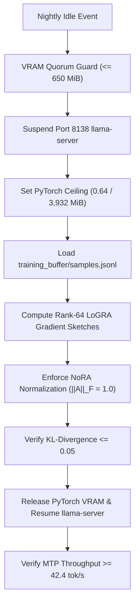

# Autonomous Offline LoGRA/NoRA Weight Evolution

## When to Use
Execute this skill during offline hibernation or scheduled nightly maintenance cycles when high-reward trajectories ($R \ge 0.85$) have accumulated in `training_buffer/samples.jsonl` and require neural weight distillation into adapter layers without exceeding hardware VRAM ceilings.

## Execution Sequence



## Step 1: Enforce Temporal Mutual Exclusion (TME)
Before initializing PyTorch backprop, verify quiescent desktop VRAM:
```python
from scenario.offline_adapter_engine import VRAMQuorumGuard

guard = VRAMQuorumGuard(max_quiescent_vram_mib=650.0)
guard.acquire_vram_quorum()
```

## Step 2: Ingest Trajectories & Project LoGRA Gradients
Read high-reward samples from `training_buffer/samples.jsonl`:
```python
from scenario.offline_adapter_engine import LoGRAGradientSketcher

sketcher = LoGRAGradientSketcher(rank=64, d_model=2048)
sketched_grad = sketcher.project_gradient(dense_grad)
```

## Step 3: Enforce NoRA Frobenius Regularization
Initialize and regularize down-projection matrices:
```python
from scenario.offline_adapter_engine import NoRAAdapterConsolidator

consolidator = NoRAAdapterConsolidator(rank=64, d_model=2048)
a_norm, f_val = consolidator.initialize_normalized_a()
assert round(f_val, 5) == 1.0
```

## Step 4: Verify KL Budget & Resume Engine
Assert policy drift $D_{KL} \le 0.05$, empty CUDA cache, and restart `llama-server`. Verify MTP draft heads $\ge 42.4$ tok/s.
