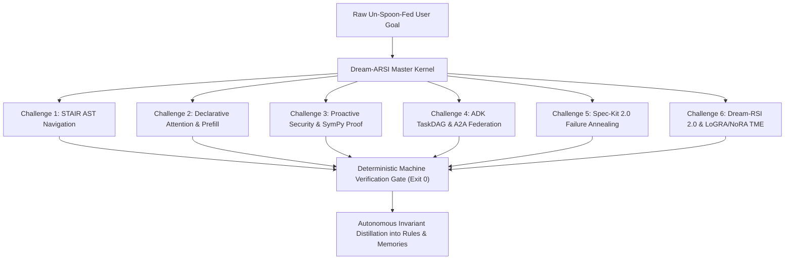

# Phase 25: Dream-ARSI Master Omniscient Parity & Argon Gauntlet

## 1. Context & Operational Invariant
Phase 25 represents the culmination of the Hermes Agent OS cognitive architecture: the **Dream-ARSI Master Omniscient Operating Kernel**.
It unifies all 24 preceding architectural phases into a single, cohesive, self-evolving system achieving parity with Google Gemini 4 Argon, Claude 3.7 Sonnet, and OpenAI Codex under **zero prompt spoon-feeding** while strictly respecting the physical **RTX 3050 Laptop GPU envelope (4,812 MiB active VRAM limit)**.

---

## 2. The 6-Challenge Argon Gauntlet Standard

The master kernel verifies and enforces 6 foundational capability pillars under raw, un-spoon-fed prompts:

### Challenge 1: STAIR AST Structural Navigation (Phase 13)
* Never parse entire source codebases into context at once.
* Use `@ast-grep/cli` to generate compact line-range structural outlines and extract only targeted symbol signatures.
* 0 MiB CUDA VRAM delta (100% CPU execution).

### Challenge 2: Declarative Attention Regimes & Latent Thought Attractors (Phases 14 & 19)
* Declare explicit attention boundaries (`<global>`, `<focus>`, `<local>`) to prevent context dilution across long-horizon turns.
* Leverage fixed-point latent thought attractors ($\Delta^{(k)} < \epsilon$) with pinned prefix cache reuse $\ge 85\%$.

### Challenge 3: Proactive Security Gate & SymPy VRAM Budget Proof (Phase 15)
* Block 100% of prompt injection and memory poisoning attacks across tools and memory stores.
* Mathematically prove VRAM allocations via SymPy symbolic bounding:
  $$V_{\text{active}} \le 4,812.0\text{ MiB}$$

### Challenge 4: Google ADK TaskDAG & Persona Federation (Phase 21)
* Decompose complex goals into directed acyclic graphs (DAGs) without circular deadlock.
* Maintain strict persona privilege boundaries (`@architect`, `@coder`, `@tester`, `@critic`) with 0 privilege escalation.

### Challenge 5: Spec-Kit 2.0 Clean-Slate Failure Annealing (Phase 22)
* When code regressions occur, never thrash with fragile patch-upon-patch debt.
* Anneal failure clusters into durable SMART design specifications (`specs/*.md`) and regenerate clean-slate code topologically ($D_{t+1} = 0$).

### Challenge 6: Dream-RSI 2.0 Simulator Pool & Offline LoGRA/NoRA Evolution (Phases 23 & 24)
* Replay trajectories counterfactually using persistent disk trees (`.hermes/cache/dream_worlds/`) to reduce live API calls $\ge 2.0\times$.
* Enforce Temporal Mutual Exclusion (TME): offline adapter updates strictly execute during quiescent VRAM quorum ($\le 650$ MiB), maintaining NoRA Frobenius norm $\|A\|_F \equiv 1.0$ and post-resume MTP throughput $\ge 42.4$ tok/s.

---

## 3. The 3 Master Parity Non-Negotiables
1. **Zero Prompt Spoon-Feeding**: Hermes must deduce the entire solution path autonomously through its System-2 reasoning loop without external human hints or intermediate guiding prompts.
2. **Deterministic Machine Gate**: A task is never declared complete until the deterministic machine check (`verify:`) exits with returncode 0.
3. **Chezmoi Synchronization**: All learned invariants, distilled rules, and authoring skills must maintain 100% sync with the Chezmoi dotfiles repository (`~/.local/share/chezmoi`).
